# PRAKTIKUM JARKOM MODUL 5 K 26 - 2026

## Angota Kelompok

| Nama                         | NRP        |
| ---------------------------- | ---------- |
| Az Zahra Fiddien Al Farabi          | 5027251021 |
| Muhammad Faturrahman | 5027241065 |

## Babak 1: Membangun Geofront 
1. Markas tanpa peta: tengah malam alarm meraung, dan Ritsuko 
terdiam. Markas sebesar ini dibangun tanpa peta alamat. Gendo 
anti pemborosan, jadi tiap subnet memakai prefix terkecil yang 
muat. Bagi prefix IP kelompokmu dengan VLSM untuk 17 LAN dan 16 
link antar-router, urut dari kebutuhan terbesar. Tunjukkan tabel 
berisi network, prefix, gateway, broadcast, IP terpakai, dan sisa. 
Tunjukkan juga gambar pohon IP, dengan subnet jalur Dummy-Plug 
ke Armisael dilingkari. Di laporan, jelaskan hitungan satu subnet.

# Hasil Perhitungan VLSM – 192.224.0.0/16

Prefix kelompok yang dipakai: **192.224.0.0/16** (dari "192.224.x.x"). Ada **17 LAN** dan **16 link antar-router**, dialokasikan berurutan dari kebutuhan terbesar.

## Aturan yang dipakai

- **Kebutuhan host LAN** = jumlah host container + 1 interface router (gateway).
- **Kebutuhan host link** = 2 interface router (link tidak punya container).
- Rumus: 2ⁿ − 2 ≥ Kebutuhan Host, lalu Prefix = 32 − n. Angka −2 pada rumus adalah Network ID dan broadcast, sehingga tidak perlu ditambahkan lagi ke kebutuhan.
- Urutan alokasi: dari block terbesar. Jika ukuran sama: **LAN dulu daripada link**, lalu urutan di tabel host. Link tidak punya nomor di tabel, jadi diurutkan dari Gendou ke luar.
- Di tiap link, router sisi pusat (lebih dekat ke Gendou) mendapat IP pertama, router sisi luar IP kedua.
- Gateway LAN = IP usable pertama.
- NAT1 bukan link antar-router, jadi tidak dihitung.
- Switch-Archive ada di tabel host tetapi tidak tampak di gambar topologi; tetap dihitung sebagai LAN ke-15 karena soal menyebut 17 LAN.

## Contoh Hitungan Satu Subnet: Switch-Lab (router Ritsuko)

Subnet ini dipilih karena termasuk jalur Dummy-Plug → Armisael.

### a. Menentukan Prefix VLSM

- **Kebutuhan Host:** 6 host (Entry-Plug 3 + Dummy-Plug 2 = 5 host, ditambah 1 interface router Ritsuko sebagai gateway).
- **Rumus:** 2ⁿ − 2 ≥ Kebutuhan Host.
- **Pencarian n (bit host):**
  - 2² − 2 = 2 (kurang)
  - 2³ − 2 = 6 (cukup, pas) → maka n = 3.
- **Prefix CIDR:** 32 − n = 32 − 3 = **/29**.

### b. Menghitung Block Size (Total IP)

- **Rumus:** 2^(32 − Prefix) = 2^(32 − 29) = 2³ = **8 IP**.
- Block size 8 kurang dari 256, jadi subnet ini hanya menggeser **oktet keempat** sebanyak 8.

### c. Menentukan Network ID (NID) dan Broadcast

- **Network ID:** subnet ini datang setelah Switch-Dock (192.224.4.32/28, block 16), sehingga NID dimulai dari `192.224.4.48`.
- **Next Network:** NID + Block Size (oktet ke-4) → 48 + 8 = 56. Subnet berikutnya dimulai di `192.224.4.56`.
- **Broadcast:** satu angka sebelum Next Network → `192.224.4.55`.

### d. Menentukan Range IP Usable

- **IP pertama:** Network ID + 1 → `192.224.4.49`.
- **IP terakhir:** Broadcast − 1 → `192.224.4.54`.
- **Range host:** `192.224.4.49 - 192.224.4.54` (6 host valid).

### e. Gateway, IP Terpakai, dan Sisa

- **Gateway:** IP pertama → `192.224.4.49` (Ritsuko).
- **IP terpakai:** 5 host + 1 gateway = 6.
- **Sisa:** 6 host valid − 6 terpakai = **0**.

## Tabel Kebutuhan dan Prefix

| Subnet | Host container | Kebutuhan (host + interface router) | n (bit host) | Prefix | Block size | Host valid | Subnet mask |
|---|---:|---:|---:|---:|---:|---:|---|
| Switch-Quarters | 500 | 501 | 9 | /23 | 512 | 510 | 255.255.254.0 |
| Switch-Comm | 200 | 201 | 8 | /24 | 256 | 254 | 255.255.255.0 |
| Switch-Hangar | 100 | 101 | 7 | /25 | 128 | 126 | 255.255.255.128 |
| Switch-Bunker | 55 | 56 | 6 | /26 | 64 | 62 | 255.255.255.192 |
| Switch-Medic | 26 | 27 | 5 | /27 | 32 | 30 | 255.255.255.224 |
| Switch-Relay | 25 | 26 | 5 | /27 | 32 | 30 | 255.255.255.224 |
| Switch-Garden | 14 | 15 | 5 | /27 | 32 | 30 | 255.255.255.224 |
| Switch-Dock | 12 | 13 | 4 | /28 | 16 | 14 | 255.255.255.240 |
| Switch-Lab | 5 | 6 | 3 | /29 | 8 | 6 | 255.255.255.248 |
| Switch-Terminal | 3 | 4 | 3 | /29 | 8 | 6 | 255.255.255.248 |
| Switch-Cage | 3 | 4 | 3 | /29 | 8 | 6 | 255.255.255.248 |
| Switch-Dogma | 2 | 3 | 3 | /29 | 8 | 6 | 255.255.255.248 |
| Switch-Monolith | 2 | 3 | 3 | /29 | 8 | 6 | 255.255.255.248 |
| Switch-Radar | 4 | 5 | 3 | /29 | 8 | 6 | 255.255.255.248 |
| Switch-Archive | 1 | 2 | 2 | /30 | 4 | 2 | 255.255.255.252 |
| Switch-Intel | 1 | 2 | 2 | /30 | 4 | 2 | 255.255.255.252 |
| Switch-Cmd | 1 | 2 | 2 | /30 | 4 | 2 | 255.255.255.252 |
| Link Gendou–Yui | 0 | 2 | 2 | /30 | 4 | 2 | 255.255.255.252 |
| Link Gendou–Hikari | 0 | 2 | 2 | /30 | 4 | 2 | 255.255.255.252 |
| Link Gendou–Fuyutsuki | 0 | 2 | 2 | /30 | 4 | 2 | 255.255.255.252 |
| Link Gendou–Asuka | 0 | 2 | 2 | /30 | 4 | 2 | 255.255.255.252 |
| Link Gendou–Kaji | 0 | 2 | 2 | /30 | 4 | 2 | 255.255.255.252 |
| Link Gendou–Misato | 0 | 2 | 2 | /30 | 4 | 2 | 255.255.255.252 |
| Link Gendou–Shigeru | 0 | 2 | 2 | /30 | 4 | 2 | 255.255.255.252 |
| Link Yui–Rei | 0 | 2 | 2 | /30 | 4 | 2 | 255.255.255.252 |
| Link Yui–Shinji | 0 | 2 | 2 | /30 | 4 | 2 | 255.255.255.252 |
| Link Yui–Mari | 0 | 2 | 2 | /30 | 4 | 2 | 255.255.255.252 |
| Link Hikari–Kaworu | 0 | 2 | 2 | /30 | 4 | 2 | 255.255.255.252 |
| Link Fuyutsuki–Maya | 0 | 2 | 2 | /30 | 4 | 2 | 255.255.255.252 |
| Link Fuyutsuki–Toji | 0 | 2 | 2 | /30 | 4 | 2 | 255.255.255.252 |
| Link Asuka–Kensuke | 0 | 2 | 2 | /30 | 4 | 2 | 255.255.255.252 |
| Link Asuka–Ritsuko | 0 | 2 | 2 | /30 | 4 | 2 | 255.255.255.252 |
| Link Shigeru–Mokoto | 0 | 2 | 2 | /30 | 4 | 2 | 255.255.255.252 |

## Tabel Hasil VLSM

★ = subnet pada jalur Dummy-Plug → Armisael (yang dilingkari di gambar pohon).

| No | Subnet | Prefix | Network ID | Range host | Broadcast | Gateway | IP terpakai | Sisa |
|---:|---|---:|---|---|---|---|---:|---:|
| 1 | Switch-Quarters | /23 | 192.224.0.0 | 192.224.0.1 - 192.224.1.254 | 192.224.1.255 | 192.224.0.1 | 501 | 9 |
| 2 | Switch-Comm | /24 | 192.224.2.0 | 192.224.2.1 - 192.224.2.254 | 192.224.2.255 | 192.224.2.1 | 201 | 53 |
| 3 | Switch-Hangar | /25 | 192.224.3.0 | 192.224.3.1 - 192.224.3.126 | 192.224.3.127 | 192.224.3.1 | 101 | 25 |
| 4 | Switch-Bunker | /26 | 192.224.3.128 | 192.224.3.129 - 192.224.3.190 | 192.224.3.191 | 192.224.3.129 | 56 | 6 |
| 5 | Switch-Medic | /27 | 192.224.3.192 | 192.224.3.193 - 192.224.3.222 | 192.224.3.223 | 192.224.3.193 | 27 | 3 |
| 6 | Switch-Relay | /27 | 192.224.3.224 | 192.224.3.225 - 192.224.3.254 | 192.224.3.255 | 192.224.3.225 | 26 | 4 |
| 7 | Switch-Garden | /27 | 192.224.4.0 | 192.224.4.1 - 192.224.4.30 | 192.224.4.31 | 192.224.4.1 | 15 | 15 |
| 8 | Switch-Dock | /28 | 192.224.4.32 | 192.224.4.33 - 192.224.4.46 | 192.224.4.47 | 192.224.4.33 | 13 | 1 |
| 9 | **Switch-Lab** ★ | /29 | 192.224.4.48 | 192.224.4.49 - 192.224.4.54 | 192.224.4.55 | 192.224.4.49 | 6 | 0 |
| 10 | Switch-Terminal | /29 | 192.224.4.56 | 192.224.4.57 - 192.224.4.62 | 192.224.4.63 | 192.224.4.57 | 4 | 2 |
| 11 | Switch-Cage | /29 | 192.224.4.64 | 192.224.4.65 - 192.224.4.70 | 192.224.4.71 | 192.224.4.65 | 4 | 2 |
| 12 | Switch-Dogma | /29 | 192.224.4.72 | 192.224.4.73 - 192.224.4.78 | 192.224.4.79 | 192.224.4.73 | 3 | 3 |
| 13 | **Switch-Monolith** ★ | /29 | 192.224.4.80 | 192.224.4.81 - 192.224.4.86 | 192.224.4.87 | 192.224.4.81 | 3 | 3 |
| 14 | Switch-Radar | /29 | 192.224.4.88 | 192.224.4.89 - 192.224.4.94 | 192.224.4.95 | 192.224.4.89 | 5 | 1 |
| 15 | Switch-Archive | /30 | 192.224.4.96 | 192.224.4.97 - 192.224.4.98 | 192.224.4.99 | 192.224.4.97 | 2 | 0 |
| 16 | Switch-Intel | /30 | 192.224.4.100 | 192.224.4.101 - 192.224.4.102 | 192.224.4.103 | 192.224.4.101 | 2 | 0 |
| 17 | Switch-Cmd | /30 | 192.224.4.104 | 192.224.4.105 - 192.224.4.106 | 192.224.4.107 | 192.224.4.105 | 2 | 0 |
| 18 | Link Gendou–Yui | /30 | 192.224.4.108 | 192.224.4.109 - 192.224.4.110 | 192.224.4.111 | - | 2 | 0 |
| 19 | Link Gendou–Hikari | /30 | 192.224.4.112 | 192.224.4.113 - 192.224.4.114 | 192.224.4.115 | - | 2 | 0 |
| 20 | Link Gendou–Fuyutsuki | /30 | 192.224.4.116 | 192.224.4.117 - 192.224.4.118 | 192.224.4.119 | - | 2 | 0 |
| 21 | **Link Gendou–Asuka** ★ | /30 | 192.224.4.120 | 192.224.4.121 - 192.224.4.122 | 192.224.4.123 | - | 2 | 0 |
| 22 | Link Gendou–Kaji | /30 | 192.224.4.124 | 192.224.4.125 - 192.224.4.126 | 192.224.4.127 | - | 2 | 0 |
| 23 | Link Gendou–Misato | /30 | 192.224.4.128 | 192.224.4.129 - 192.224.4.130 | 192.224.4.131 | - | 2 | 0 |
| 24 | **Link Gendou–Shigeru** ★ | /30 | 192.224.4.132 | 192.224.4.133 - 192.224.4.134 | 192.224.4.135 | - | 2 | 0 |
| 25 | Link Yui–Rei | /30 | 192.224.4.136 | 192.224.4.137 - 192.224.4.138 | 192.224.4.139 | - | 2 | 0 |
| 26 | Link Yui–Shinji | /30 | 192.224.4.140 | 192.224.4.141 - 192.224.4.142 | 192.224.4.143 | - | 2 | 0 |
| 27 | Link Yui–Mari | /30 | 192.224.4.144 | 192.224.4.145 - 192.224.4.146 | 192.224.4.147 | - | 2 | 0 |
| 28 | Link Hikari–Kaworu | /30 | 192.224.4.148 | 192.224.4.149 - 192.224.4.150 | 192.224.4.151 | - | 2 | 0 |
| 29 | Link Fuyutsuki–Maya | /30 | 192.224.4.152 | 192.224.4.153 - 192.224.4.154 | 192.224.4.155 | - | 2 | 0 |
| 30 | Link Fuyutsuki–Toji | /30 | 192.224.4.156 | 192.224.4.157 - 192.224.4.158 | 192.224.4.159 | - | 2 | 0 |
| 31 | Link Asuka–Kensuke | /30 | 192.224.4.160 | 192.224.4.161 - 192.224.4.162 | 192.224.4.163 | - | 2 | 0 |
| 32 | **Link Asuka–Ritsuko** ★ | /30 | 192.224.4.164 | 192.224.4.165 - 192.224.4.166 | 192.224.4.167 | - | 2 | 0 |
| 33 | Link Shigeru–Mokoto | /30 | 192.224.4.168 | 192.224.4.169 - 192.224.4.170 | 192.224.4.171 | - | 2 | 0 |

**Ringkasan:**
- Total alamat teralokasi: **1,196**
- Total IP terpakai: **1,003**
- Total sisa di dalam block: **127**
- Alamat terakhir yang dipakai: **192.224.4.171**, masih di dalam 192.224.0.0/16.

## Alamat Tiap Link Antar-Router

- Gendou–Yui: 192.224.4.108/30 → Gendou 192.224.4.109 | Yui 192.224.4.110
- Gendou–Hikari: 192.224.4.112/30 → Gendou 192.224.4.113 | Hikari 192.224.4.114
- Gendou–Fuyutsuki: 192.224.4.116/30 → Gendou 192.224.4.117 | Fuyutsuki 192.224.4.118
- Gendou–Asuka: 192.224.4.120/30 → Gendou 192.224.4.121 | Asuka 192.224.4.122
- Gendou–Kaji: 192.224.4.124/30 → Gendou 192.224.4.125 | Kaji 192.224.4.126
- Gendou–Misato: 192.224.4.128/30 → Gendou 192.224.4.129 | Misato 192.224.4.130
- Gendou–Shigeru: 192.224.4.132/30 → Gendou 192.224.4.133 | Shigeru 192.224.4.134
- Yui–Rei: 192.224.4.136/30 → Yui 192.224.4.137 | Rei 192.224.4.138
- Yui–Shinji: 192.224.4.140/30 → Yui 192.224.4.141 | Shinji 192.224.4.142
- Yui–Mari: 192.224.4.144/30 → Yui 192.224.4.145 | Mari 192.224.4.146
- Hikari–Kaworu: 192.224.4.148/30 → Hikari 192.224.4.149 | Kaworu 192.224.4.150
- Fuyutsuki–Maya: 192.224.4.152/30 → Fuyutsuki 192.224.4.153 | Maya 192.224.4.154
- Fuyutsuki–Toji: 192.224.4.156/30 → Fuyutsuki 192.224.4.157 | Toji 192.224.4.158
- Asuka–Kensuke: 192.224.4.160/30 → Asuka 192.224.4.161 | Kensuke 192.224.4.162
- Asuka–Ritsuko: 192.224.4.164/30 → Asuka 192.224.4.165 | Ritsuko 192.224.4.166
- Shigeru–Mokoto: 192.224.4.168/30 → Shigeru 192.224.4.169 | Mokoto 192.224.4.170

## Jalur Dummy-Plug → Armisael

Dummy-Plug → Switch-Lab → Ritsuko → Asuka → Gendou → Shigeru → Switch-Monolith → Armisael

Subnet yang dilingkari di pohon IP:

1. Switch-Lab: 192.224.4.48/29
2. Link Asuka–Ritsuko: 192.224.4.164/30
3. Link Gendou–Asuka: 192.224.4.120/30
4. Link Gendou–Shigeru: 192.224.4.132/30
5. Switch-Monolith: 192.224.4.80/29

## Pohon IP

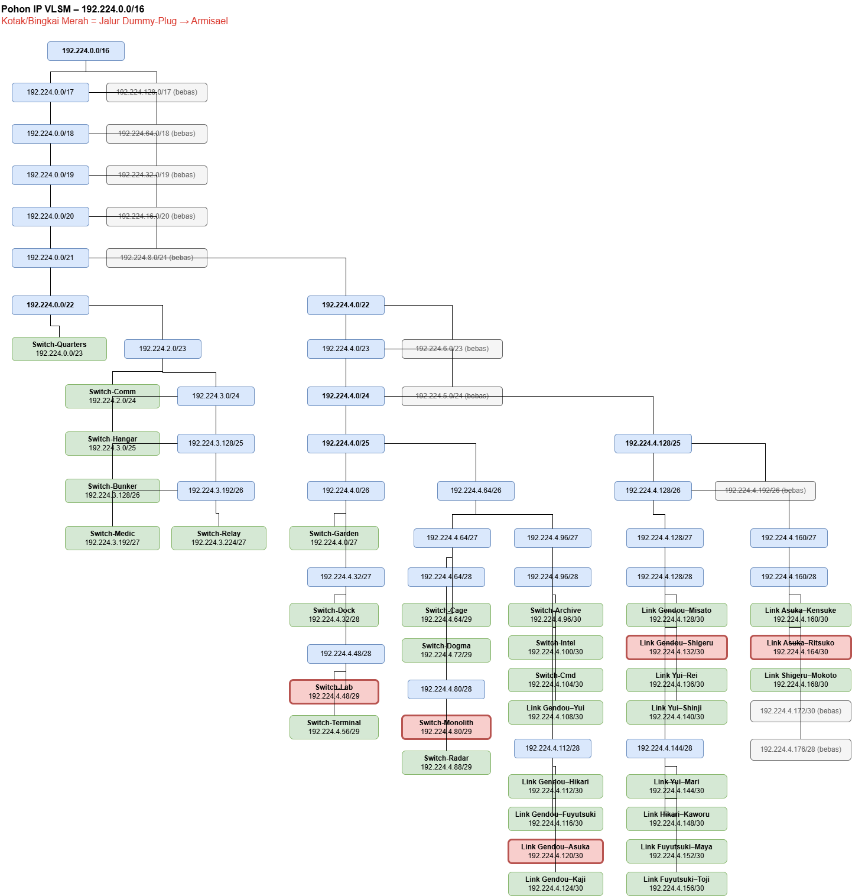

2. Geofront gelap gulita: kabel sudah ditarik, tapi saat Misato menekan 
tombol daya, Geofront tetap gelap. Tidak ada alamat dan tidak ada 
rute. Pasang semua node di GNS3 sesuai topologi. Beri IP ke tiap 
interface router sesuai soal 1, lalu aktifkan IP forwarding di semua 
router. Hanya Gendo yang terhubung ke NAT1 dan mendapat alamat 
lewat DHCP. Router lain baru bisa memasang paket setelah soal 4, 
karena internet baru ada saat itu. Tunjukkan ip -br di tiap router dan 
ping dua ujung tiap link router ke router.

## Jawaban Soal 2: Menyalakan Geofront

### Ringkasan

- Semua router dan client dipasang di GNS3 sesuai topologi. Switch-Archive tidak ada di gambar topologi, jadi ditambahkan sendiri di **Asuka eth3** (sesuai tabel host: gateway Archive = Asuka).
- Setiap interface router diberi IP sesuai tabel VLSM soal 1. Di link, router sisi Gendou mendapat IP pertama.
- Hanya **Gendou eth0** yang tersambung ke **NAT1** dan memakai DHCP.
- IP forwarding diaktifkan di semua router lewat baris `up echo 1 > /proc/sys/net/ipv4/ip_forward`. Cara ini tidak butuh paket tambahan, jadi aman dipakai sebelum ada internet (soal 4).
- Routing antar-subnet belum dipasang. Di soal ini cukup ping antar ujung link yang terhubung langsung.
- Client belum diberi IP karena soal hanya meminta interface router.

### Tabel Interface Router

| Router | Interface | IP / Prefix | Keterangan |
|---|---|---|---|
| Gendou | eth0 | 192.168.122.252/24 (DHCP dari NAT1) | Ke internet |
| Gendou | eth1 | 192.224.4.109/30 | Link Gendou-Yui |
| Gendou | eth2 | 192.224.4.105/30 | LAN Switch-Cmd (gateway) |
| Gendou | eth3 | 192.224.4.113/30 | Link Gendou-Hikari |
| Gendou | eth4 | 192.224.4.117/30 | Link Gendou-Fuyutsuki |
| Gendou | eth5 | 192.224.4.121/30 | Link Gendou-Asuka |
| Gendou | eth6 | 192.224.4.125/30 | Link Gendou-Kaji |
| Gendou | eth7 | 192.224.4.129/30 | Link Gendou-Misato |
| Gendou | eth8 | 192.224.4.133/30 | Link Gendou-Shigeru |
| Yui | eth0 | 192.224.4.110/30 | Link Gendou-Yui |
| Yui | eth1 | 192.224.4.141/30 | Link Yui-Shinji |
| Yui | eth2 | 192.224.4.137/30 | Link Yui-Rei |
| Yui | eth3 | 192.224.4.145/30 | Link Yui-Mari |
| Yui | eth4 | 192.224.3.1/25 | LAN Switch-Hangar (gateway) |
| Rei | eth0 | 192.224.4.138/30 | Link Yui-Rei |
| Rei | eth1 | 192.224.0.1/23 | LAN Switch-Quarters (gateway) |
| Shinji | eth0 | 192.224.4.142/30 | Link Yui-Shinji |
| Shinji | eth1 | 192.224.4.1/27 | LAN Switch-Garden (gateway) |
| Mari | eth0 | 192.224.4.146/30 | Link Yui-Mari |
| Mari | eth1 | 192.224.4.33/28 | LAN Switch-Dock (gateway) |
| Hikari | eth0 | 192.224.4.114/30 | Link Gendou-Hikari |
| Hikari | eth1 | 192.224.4.149/30 | Link Hikari-Kaworu |
| Hikari | eth2 | 192.224.2.1/24 | LAN Switch-Comm (gateway) |
| Kaworu | eth0 | 192.224.4.150/30 | Link Hikari-Kaworu |
| Kaworu | eth1 | 192.224.3.225/27 | LAN Switch-Relay (gateway) |
| Fuyutsuki | eth0 | 192.224.4.118/30 | Link Gendou-Fuyutsuki |
| Fuyutsuki | eth1 | 192.224.4.57/29 | LAN Switch-Terminal (gateway) |
| Fuyutsuki | eth2 | 192.224.4.153/30 | Link Fuyutsuki-Maya |
| Fuyutsuki | eth3 | 192.224.4.157/30 | Link Fuyutsuki-Toji |
| Maya | eth0 | 192.224.4.154/30 | Link Fuyutsuki-Maya |
| Maya | eth1 | 192.224.3.193/27 | LAN Switch-Medic (gateway) |
| Toji | eth0 | 192.224.4.158/30 | Link Fuyutsuki-Toji |
| Toji | eth1 | 192.224.4.73/29 | LAN Switch-Dogma (gateway) |
| Asuka | eth0 | 192.224.4.122/30 | Link Gendou-Asuka |
| Asuka | eth1 | 192.224.4.161/30 | Link Asuka-Kensuke |
| Asuka | eth2 | 192.224.4.165/30 | Link Asuka-Ritsuko |
| Asuka | eth3 | 192.224.4.97/30 | LAN Switch-Archive (gateway) |
| Kensuke | eth0 | 192.224.4.162/30 | Link Asuka-Kensuke |
| Kensuke | eth1 | 192.224.3.129/26 | LAN Switch-Bunker (gateway) |
| Ritsuko | eth0 | 192.224.4.166/30 | Link Asuka-Ritsuko |
| Ritsuko | eth1 | 192.224.4.49/29 | LAN Switch-Lab (gateway) |
| Kaji | eth0 | 192.224.4.126/30 | Link Gendou-Kaji |
| Kaji | eth1 | 192.224.4.101/30 | LAN Switch-Intel (gateway) |
| Misato | eth0 | 192.224.4.130/30 | Link Gendou-Misato |
| Misato | eth1 | 192.224.4.65/29 | LAN Switch-Cage (gateway) |
| Shigeru | eth0 | 192.224.4.134/30 | Link Gendou-Shigeru |
| Shigeru | eth1 | 192.224.4.81/29 | LAN Switch-Monolith (gateway) |
| Shigeru | eth2 | 192.224.4.169/30 | Link Shigeru-Mokoto |
| Mokoto | eth0 | 192.224.4.170/30 | Link Shigeru-Mokoto |
| Mokoto | eth1 | 192.224.4.89/29 | LAN Switch-Radar (gateway) |

### Konfigurasi Tiap Router

Konfigurasi ditaruh di menu **Configure → Edit network configuration** (`/etc/network/interfaces`) pada tiap node router. File yang sama juga ada di folder [config](config).

<details>
<summary><b>Gendou</b></summary>

```
# Gendou - /etc/network/interfaces
auto eth0
iface eth0 inet dhcp
    # NAT1 (internet), IP dari DHCP
    up echo 1 > /proc/sys/net/ipv4/ip_forward

auto eth1
iface eth1 inet static
    # Link Gendou-Yui
    address 192.224.4.109
    netmask 255.255.255.252

auto eth2
iface eth2 inet static
    # LAN Switch-Cmd (gateway)
    address 192.224.4.105
    netmask 255.255.255.252

auto eth3
iface eth3 inet static
    # Link Gendou-Hikari
    address 192.224.4.113
    netmask 255.255.255.252

auto eth4
iface eth4 inet static
    # Link Gendou-Fuyutsuki
    address 192.224.4.117
    netmask 255.255.255.252

auto eth5
iface eth5 inet static
    # Link Gendou-Asuka
    address 192.224.4.121
    netmask 255.255.255.252

auto eth6
iface eth6 inet static
    # Link Gendou-Kaji
    address 192.224.4.125
    netmask 255.255.255.252

auto eth7
iface eth7 inet static
    # Link Gendou-Misato
    address 192.224.4.129
    netmask 255.255.255.252

auto eth8
iface eth8 inet static
    # Link Gendou-Shigeru
    address 192.224.4.133
    netmask 255.255.255.252
```

</details>

<details>
<summary><b>Yui</b></summary>

```
# Yui - /etc/network/interfaces
auto eth0
iface eth0 inet static
    # Link Gendou-Yui
    address 192.224.4.110
    netmask 255.255.255.252
    up echo 1 > /proc/sys/net/ipv4/ip_forward

auto eth1
iface eth1 inet static
    # Link Yui-Shinji
    address 192.224.4.141
    netmask 255.255.255.252

auto eth2
iface eth2 inet static
    # Link Yui-Rei
    address 192.224.4.137
    netmask 255.255.255.252

auto eth3
iface eth3 inet static
    # Link Yui-Mari
    address 192.224.4.145
    netmask 255.255.255.252

auto eth4
iface eth4 inet static
    # LAN Switch-Hangar (gateway)
    address 192.224.3.1
    netmask 255.255.255.128
```

</details>

<details>
<summary><b>Rei</b></summary>

```
# Rei - /etc/network/interfaces
auto eth0
iface eth0 inet static
    # Link Yui-Rei
    address 192.224.4.138
    netmask 255.255.255.252
    up echo 1 > /proc/sys/net/ipv4/ip_forward

auto eth1
iface eth1 inet static
    # LAN Switch-Quarters (gateway)
    address 192.224.0.1
    netmask 255.255.254.0
```

</details>

<details>
<summary><b>Shinji</b></summary>

```
# Shinji - /etc/network/interfaces
auto eth0
iface eth0 inet static
    # Link Yui-Shinji
    address 192.224.4.142
    netmask 255.255.255.252
    up echo 1 > /proc/sys/net/ipv4/ip_forward

auto eth1
iface eth1 inet static
    # LAN Switch-Garden (gateway)
    address 192.224.4.1
    netmask 255.255.255.224
```

</details>

<details>
<summary><b>Mari</b></summary>

```
# Mari - /etc/network/interfaces
auto eth0
iface eth0 inet static
    # Link Yui-Mari
    address 192.224.4.146
    netmask 255.255.255.252
    up echo 1 > /proc/sys/net/ipv4/ip_forward

auto eth1
iface eth1 inet static
    # LAN Switch-Dock (gateway)
    address 192.224.4.33
    netmask 255.255.255.240
```

</details>

<details>
<summary><b>Hikari</b></summary>

```
# Hikari - /etc/network/interfaces
auto eth0
iface eth0 inet static
    # Link Gendou-Hikari
    address 192.224.4.114
    netmask 255.255.255.252
    up echo 1 > /proc/sys/net/ipv4/ip_forward

auto eth1
iface eth1 inet static
    # Link Hikari-Kaworu
    address 192.224.4.149
    netmask 255.255.255.252

auto eth2
iface eth2 inet static
    # LAN Switch-Comm (gateway)
    address 192.224.2.1
    netmask 255.255.255.0
```

</details>

<details>
<summary><b>Kaworu</b></summary>

```
# Kaworu - /etc/network/interfaces
auto eth0
iface eth0 inet static
    # Link Hikari-Kaworu
    address 192.224.4.150
    netmask 255.255.255.252
    up echo 1 > /proc/sys/net/ipv4/ip_forward

auto eth1
iface eth1 inet static
    # LAN Switch-Relay (gateway)
    address 192.224.3.225
    netmask 255.255.255.224
```

</details>

<details>
<summary><b>Fuyutsuki</b></summary>

```
# Fuyutsuki - /etc/network/interfaces
auto eth0
iface eth0 inet static
    # Link Gendou-Fuyutsuki
    address 192.224.4.118
    netmask 255.255.255.252
    up echo 1 > /proc/sys/net/ipv4/ip_forward

auto eth1
iface eth1 inet static
    # LAN Switch-Terminal (gateway)
    address 192.224.4.57
    netmask 255.255.255.248

auto eth2
iface eth2 inet static
    # Link Fuyutsuki-Maya
    address 192.224.4.153
    netmask 255.255.255.252

auto eth3
iface eth3 inet static
    # Link Fuyutsuki-Toji
    address 192.224.4.157
    netmask 255.255.255.252
```

</details>

<details>
<summary><b>Maya</b></summary>

```
# Maya - /etc/network/interfaces
auto eth0
iface eth0 inet static
    # Link Fuyutsuki-Maya
    address 192.224.4.154
    netmask 255.255.255.252
    up echo 1 > /proc/sys/net/ipv4/ip_forward

auto eth1
iface eth1 inet static
    # LAN Switch-Medic (gateway)
    address 192.224.3.193
    netmask 255.255.255.224
```

</details>

<details>
<summary><b>Toji</b></summary>

```
# Toji - /etc/network/interfaces
auto eth0
iface eth0 inet static
    # Link Fuyutsuki-Toji
    address 192.224.4.158
    netmask 255.255.255.252
    up echo 1 > /proc/sys/net/ipv4/ip_forward

auto eth1
iface eth1 inet static
    # LAN Switch-Dogma (gateway)
    address 192.224.4.73
    netmask 255.255.255.248
```

</details>

<details>
<summary><b>Asuka</b></summary>

```
# Asuka - /etc/network/interfaces
auto eth0
iface eth0 inet static
    # Link Gendou-Asuka
    address 192.224.4.122
    netmask 255.255.255.252
    up echo 1 > /proc/sys/net/ipv4/ip_forward

auto eth1
iface eth1 inet static
    # Link Asuka-Kensuke
    address 192.224.4.161
    netmask 255.255.255.252

auto eth2
iface eth2 inet static
    # Link Asuka-Ritsuko
    address 192.224.4.165
    netmask 255.255.255.252

auto eth3
iface eth3 inet static
    # LAN Switch-Archive (gateway)
    address 192.224.4.97
    netmask 255.255.255.252
```

</details>

<details>
<summary><b>Kensuke</b></summary>

```
# Kensuke - /etc/network/interfaces
auto eth0
iface eth0 inet static
    # Link Asuka-Kensuke
    address 192.224.4.162
    netmask 255.255.255.252
    up echo 1 > /proc/sys/net/ipv4/ip_forward

auto eth1
iface eth1 inet static
    # LAN Switch-Bunker (gateway)
    address 192.224.3.129
    netmask 255.255.255.192
```

</details>

<details>
<summary><b>Ritsuko</b></summary>

```
# Ritsuko - /etc/network/interfaces
auto eth0
iface eth0 inet static
    # Link Asuka-Ritsuko
    address 192.224.4.166
    netmask 255.255.255.252
    up echo 1 > /proc/sys/net/ipv4/ip_forward

auto eth1
iface eth1 inet static
    # LAN Switch-Lab (gateway)
    address 192.224.4.49
    netmask 255.255.255.248
```

</details>

<details>
<summary><b>Kaji</b></summary>

```
# Kaji - /etc/network/interfaces
auto eth0
iface eth0 inet static
    # Link Gendou-Kaji
    address 192.224.4.126
    netmask 255.255.255.252
    up echo 1 > /proc/sys/net/ipv4/ip_forward

auto eth1
iface eth1 inet static
    # LAN Switch-Intel (gateway)
    address 192.224.4.101
    netmask 255.255.255.252
```

</details>

<details>
<summary><b>Misato</b></summary>

```
# Misato - /etc/network/interfaces
auto eth0
iface eth0 inet static
    # Link Gendou-Misato
    address 192.224.4.130
    netmask 255.255.255.252
    up echo 1 > /proc/sys/net/ipv4/ip_forward

auto eth1
iface eth1 inet static
    # LAN Switch-Cage (gateway)
    address 192.224.4.65
    netmask 255.255.255.248
```

</details>

<details>
<summary><b>Shigeru</b></summary>

```
# Shigeru - /etc/network/interfaces
auto eth0
iface eth0 inet static
    # Link Gendou-Shigeru
    address 192.224.4.134
    netmask 255.255.255.252
    up echo 1 > /proc/sys/net/ipv4/ip_forward

auto eth1
iface eth1 inet static
    # LAN Switch-Monolith (gateway)
    address 192.224.4.81
    netmask 255.255.255.248

auto eth2
iface eth2 inet static
    # Link Shigeru-Mokoto
    address 192.224.4.169
    netmask 255.255.255.252
```

</details>

<details>
<summary><b>Mokoto</b></summary>

```
# Mokoto - /etc/network/interfaces
auto eth0
iface eth0 inet static
    # Link Shigeru-Mokoto
    address 192.224.4.170
    netmask 255.255.255.252
    up echo 1 > /proc/sys/net/ipv4/ip_forward

auto eth1
iface eth1 inet static
    # LAN Switch-Radar (gateway)
    address 192.224.4.89
    netmask 255.255.255.248
```

</details>


Semua perintah tes per router juga ada di [tes_soal2.sh](config/tes_soal2.sh).

#### Daftar Ping Tiap Link

| Jalankan di | Perintah | Ujung yang diping |
|---|---|---|
| Gendou | `ping -c 3 192.224.4.110` | Yui (eth0) |
| Gendou | `ping -c 3 192.224.4.114` | Hikari (eth0) |
| Gendou | `ping -c 3 192.224.4.118` | Fuyutsuki (eth0) |
| Gendou | `ping -c 3 192.224.4.122` | Asuka (eth0) |
| Gendou | `ping -c 3 192.224.4.126` | Kaji (eth0) |
| Gendou | `ping -c 3 192.224.4.130` | Misato (eth0) |
| Gendou | `ping -c 3 192.224.4.134` | Shigeru (eth0) |
| Yui | `ping -c 3 192.224.4.109` | Gendou (eth1) |
| Yui | `ping -c 3 192.224.4.138` | Rei (eth0) |
| Yui | `ping -c 3 192.224.4.142` | Shinji (eth0) |
| Yui | `ping -c 3 192.224.4.146` | Mari (eth0) |
| Rei | `ping -c 3 192.224.4.137` | Yui (eth2) |
| Shinji | `ping -c 3 192.224.4.141` | Yui (eth1) |
| Mari | `ping -c 3 192.224.4.145` | Yui (eth3) |
| Hikari | `ping -c 3 192.224.4.113` | Gendou (eth3) |
| Hikari | `ping -c 3 192.224.4.150` | Kaworu (eth0) |
| Kaworu | `ping -c 3 192.224.4.149` | Hikari (eth1) |
| Fuyutsuki | `ping -c 3 192.224.4.117` | Gendou (eth4) |
| Fuyutsuki | `ping -c 3 192.224.4.154` | Maya (eth0) |
| Fuyutsuki | `ping -c 3 192.224.4.158` | Toji (eth0) |
| Maya | `ping -c 3 192.224.4.153` | Fuyutsuki (eth2) |
| Toji | `ping -c 3 192.224.4.157` | Fuyutsuki (eth3) |
| Asuka | `ping -c 3 192.224.4.121` | Gendou (eth5) |
| Asuka | `ping -c 3 192.224.4.162` | Kensuke (eth0) |
| Asuka | `ping -c 3 192.224.4.166` | Ritsuko (eth0) |
| Kensuke | `ping -c 3 192.224.4.161` | Asuka (eth1) |
| Ritsuko | `ping -c 3 192.224.4.165` | Asuka (eth2) |
| Kaji | `ping -c 3 192.224.4.125` | Gendou (eth6) |
| Misato | `ping -c 3 192.224.4.129` | Gendou (eth7) |
| Shigeru | `ping -c 3 192.224.4.133` | Gendou (eth8) |
| Shigeru | `ping -c 3 192.224.4.170` | Mokoto (eth0) |
| Mokoto | `ping -c 3 192.224.4.169` | Shigeru (eth2) |

### Hasil Pengujian (`ip -br a`, `ip_forward`, dan Ping Tiap Router)

#### 1. Gendou
`eth0` mendapat IP `192.168.122.252/24` lewat DHCP dari NAT1 dan berhasil `ping 8.8.8.8`.

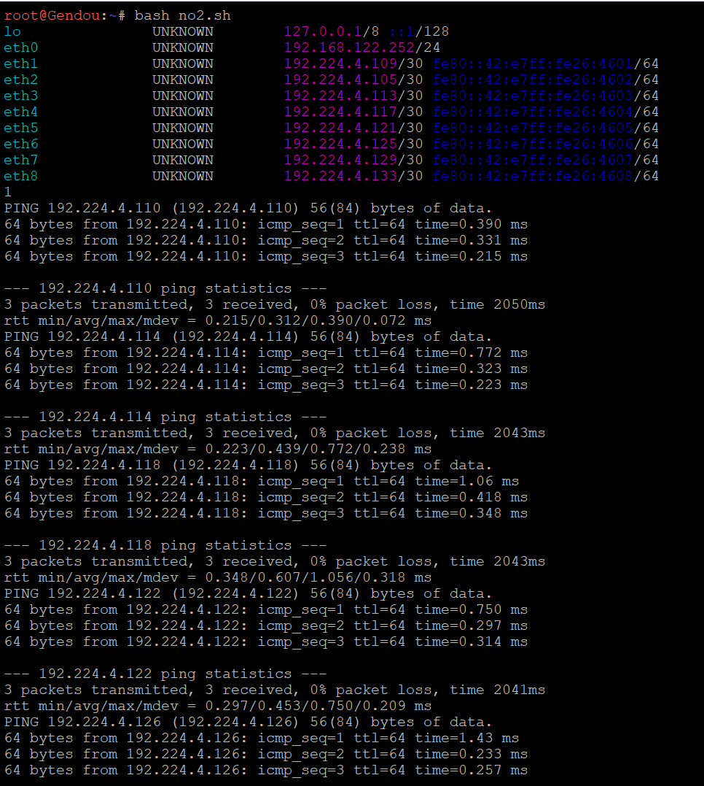
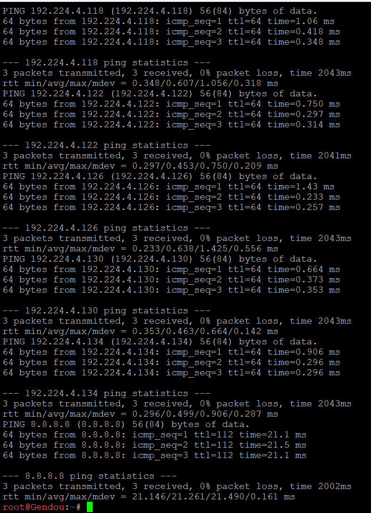

#### 2. Yui
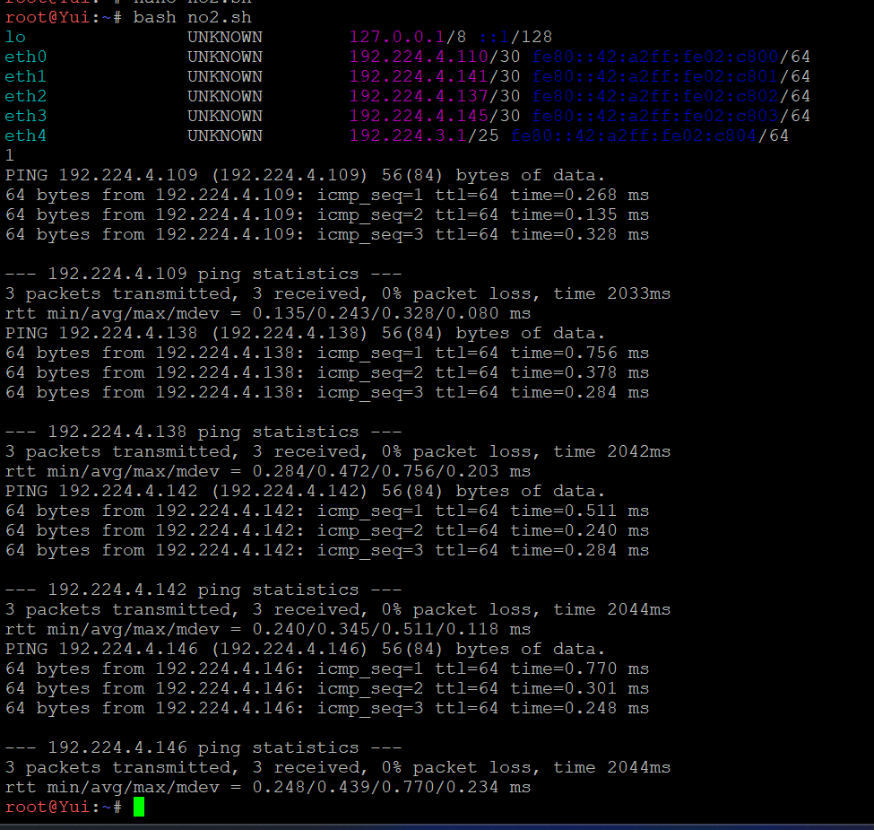

#### 3. Rei
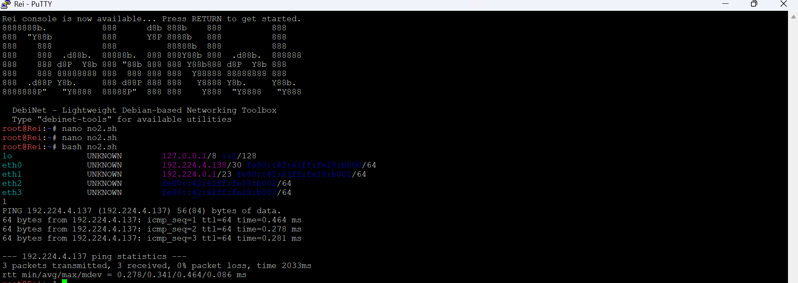

#### 4. Shinji
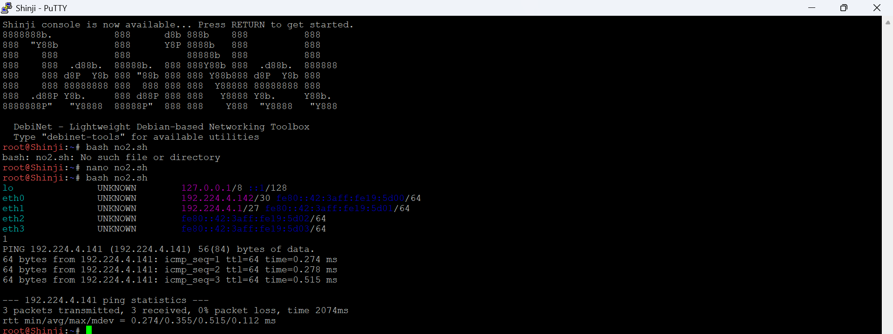

#### 5. Mari
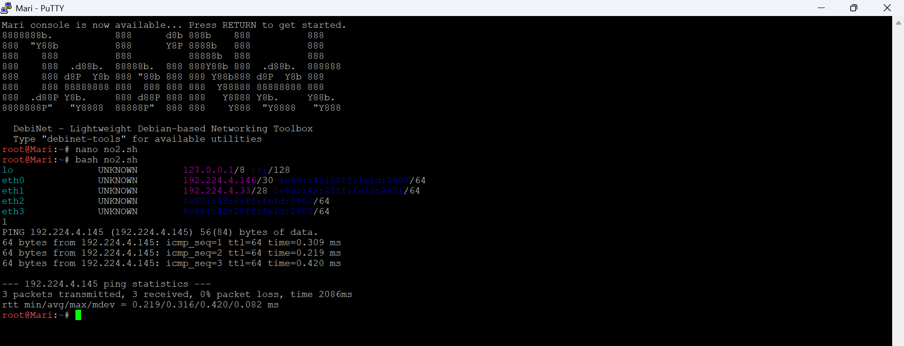

#### 6. Hikari
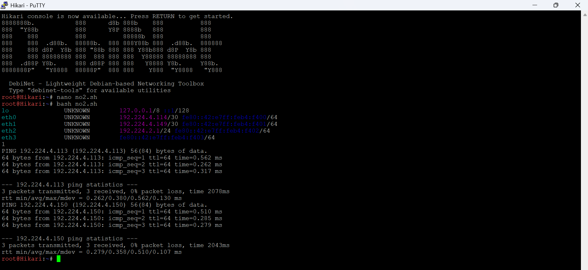

#### 7. Kaworu
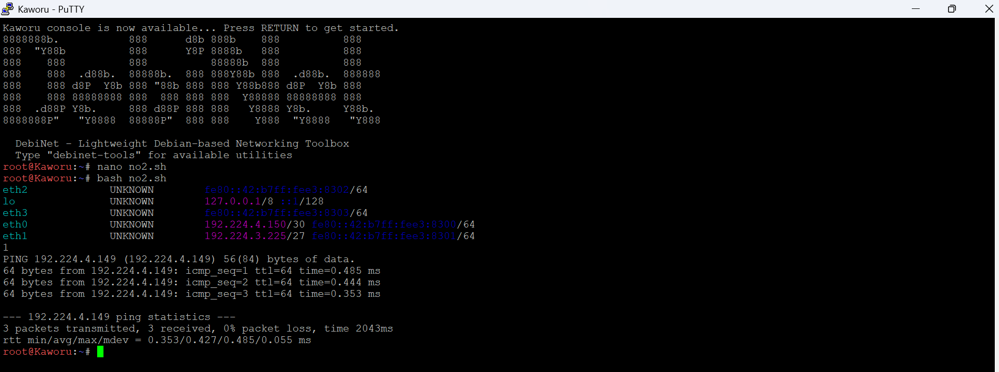

#### 8. Fuyutsuki
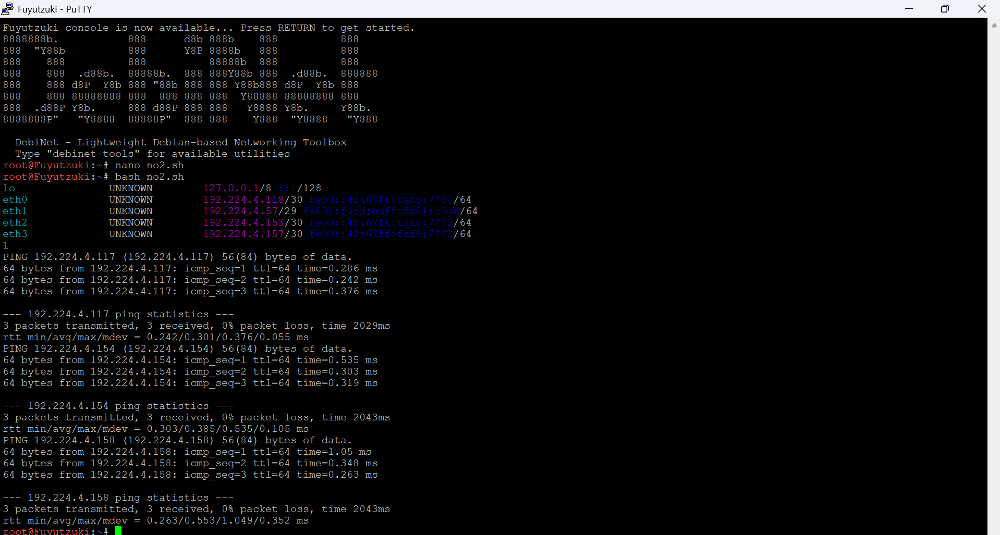

#### 9. Maya


#### 10. Toji
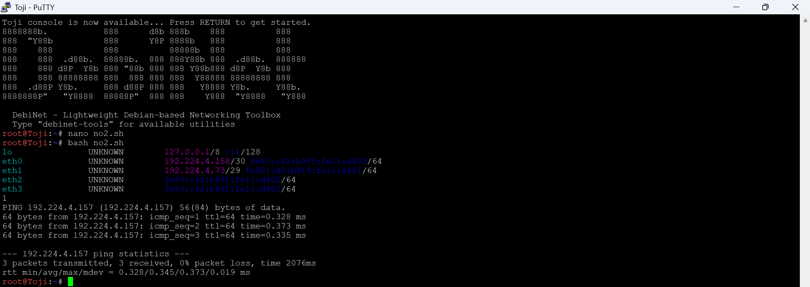

#### 11. Asuka
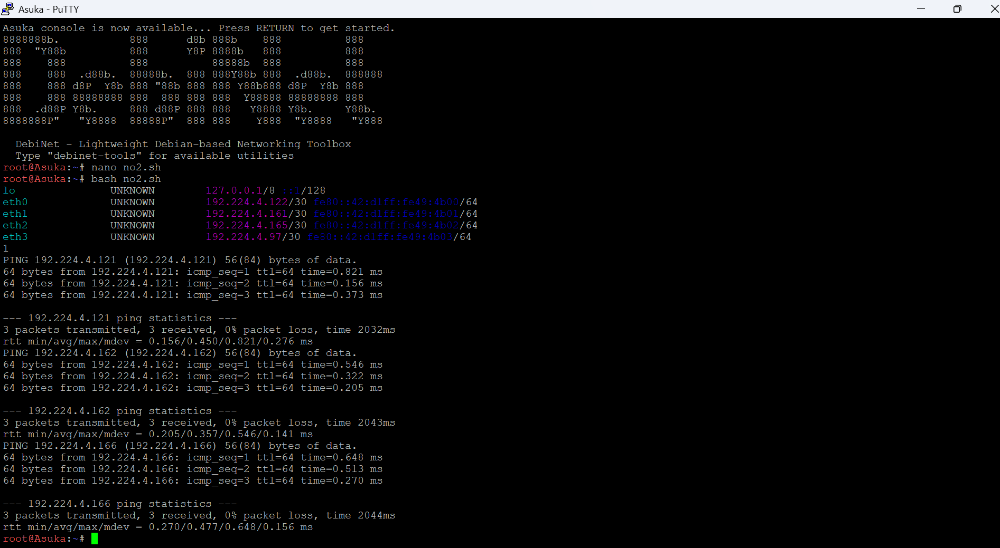

#### 12. Kensuke


#### 13. Ritsuko
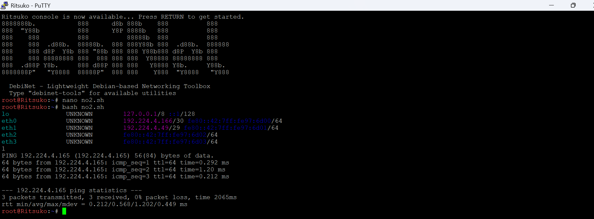

#### 14. Kaji


#### 15. Misato
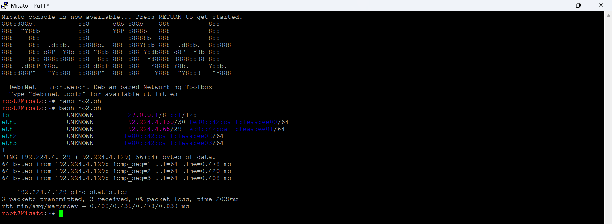

#### 16. Shigeru
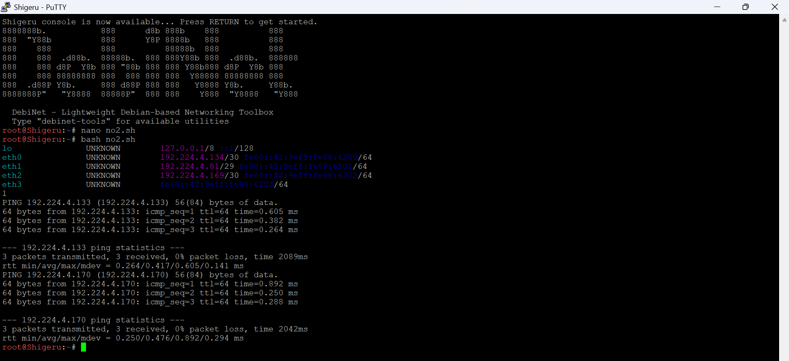

#### 17. Mokoto
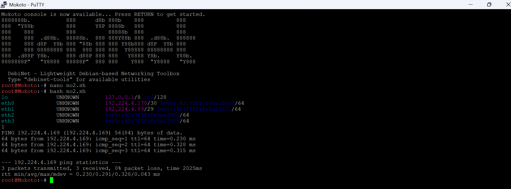

3.  Pulau-pulau yang terpisah: lampu mulai menyala, tapi tiap 
segmen masih seperti pulau terpisah. Fuyutsuki mengingatkan: 
bangun jalur dari Gendo ke bawah, cabang demi cabang. 
Hubungkan semua subnet dengan routing statis dan jumlah rute 
sesedikit mungkin. Router selain Gendo cukup punya satu default 
route ke atas dan rute untuk subnet di bawahnya. Gendo memakai 
default route ke NAT1. Subnet satu cabang yang bisa digabung tepat 
menjadi satu CIDR harus diringkas. Untuk soal 3 sampai 5, beri IP 
dan gateway sementara pada node uji. IP permanen dibuat di soal 
6. Buktikan Armisael bisa ping ke Lilith, Sachiel, dan Comm-Net.

---

## Soal 3: Pulau-Pulau yang Terpisah (Static Routing & CIDR Summarization)

> **Soal:**
> 3. Pulau-pulau yang terpisah: lampu mulai menyala, tapi tiap segmen masih seperti pulau terpisah. Fuyutsuki mengingatkan: bangun jalur dari Gendo ke bawah, cabang demi cabang. Hubungkan semua subnet dengan routing statis dan jumlah rute sesedikit mungkin. Router selain Gendo cukup punya satu default route ke atas dan rute untuk subnet di bawahnya. Gendo memakai default route ke NAT1. Subnet satu cabang yang bisa digabung tepat menjadi satu CIDR harus diringkas. Untuk soal 3 sampai 5, beri IP dan gateway sementara pada node uji. IP permanen dibuat di soal 6. Buktikan Armisael bisa ping ke Lilith, Sachiel, dan Comm-Net.

### Perhitungan Ringkasan Rute (Exact CIDR Summarization)

Aturan routing yang dipakai:
- **Gendou** memiliki default route otomatis ke **NAT1** (lewat DHCP pada `eth0`), ditambah rute statis untuk semua subnet di bawah ketujuh cabangnya.
- **Router selain Gendou** (16 router) hanya memiliki **1 default route ke atas** (`gateway <IP parent>` pada `eth0`) dan rute statis untuk subnet di bawahnya (jika punya router anak).
- **11 router daun** (Rei, Shinji, Mari, Kaworu, Maya, Toji, Kensuke, Ritsuko, Kaji, Misato, Mokoto) tidak punya router anak, sehingga **tidak butuh rute ke bawah** — cukup 1 default route ke atas.
- Subnet dalam satu cabang yang bersebelahan dan memenuhi batas blok CIDR digabung **tepat** (tanpa mencakup subnet cabang lain atau ruang kosong).

#### 1. Pengecekan Penggabungan Subnet di Cabang Gendou

| Cabang (via) | Subnet di Bawah Cabang | Bisa Diringkas Tepat? | Hasil Rute di Gendou |
|---|---|---|---|
| **Yui** (192.224.4.110) | 192.224.0.0/23 (Quarters)<br>192.224.3.0/25 (Hangar)<br>192.224.4.0/27 (Garden)<br>192.224.4.32/28 (Dock)<br>192.224.4.136/30 (Yui–Rei)<br>192.224.4.140/30 (Yui–Shinji)<br>192.224.4.144/30 (Yui–Mari) | Ya: .136/30 + .140/30 = **192.224.4.136/29**<br>*(.136 kelipatan 8, berurutan hingga .143; .144/30 tidak punya pasangan .148/30 di cabang ini)* | 192.224.0.0/23<br>192.224.3.0/25<br>192.224.4.0/27<br>192.224.4.32/28<br>**192.224.4.136/29**<br>192.224.4.144/30<br>*(7 → 6 rute)* |
| **Hikari** (192.224.4.114) | 192.224.2.0/24 (Comm)<br>192.224.3.224/27 (Relay)<br>192.224.4.148/30 (Hikari–Kaworu) | Tidak ada pasangan yang sejajar dan berurutan dalam cabang ini | 192.224.2.0/24<br>192.224.3.224/27<br>192.224.4.148/30<br>*(3 rute)* |
| **Fuyutsuki** (192.224.4.118) | 192.224.3.192/27 (Medic)<br>192.224.4.56/29 (Terminal)<br>192.224.4.72/29 (Dogma)<br>192.224.4.152/30 (Fuyutsuki–Maya)<br>192.224.4.156/30 (Fuyutsuki–Toji) | Ya: .152/30 + .156/30 = **192.224.4.152/29**<br>*(.152 kelipatan 8, berurutan hingga .159)* | 192.224.3.192/27<br>192.224.4.56/29<br>192.224.4.72/29<br>**192.224.4.152/29**<br>*(5 → 4 rute)* |
| **Asuka** (192.224.4.122) | 192.224.3.128/26 (Bunker)<br>192.224.4.48/29 (Lab)<br>192.224.4.96/30 (Archive)<br>192.224.4.160/30 (Asuka–Kensuke)<br>192.224.4.164/30 (Asuka–Ritsuko) | Ya: .160/30 + .164/30 = **192.224.4.160/29**<br>*(.160 kelipatan 8, berurutan hingga .167)* | 192.224.3.128/26<br>192.224.4.48/29<br>192.224.4.96/30<br>**192.224.4.160/29**<br>*(5 → 4 rute)* |
| **Kaji** (192.224.4.126) | 192.224.4.100/30 (Intel) | Hanya 1 subnet | 192.224.4.100/30 *(1 rute)* |
| **Misato** (192.224.4.130) | 192.224.4.64/29 (Cage) | Hanya 1 subnet | 192.224.4.64/29 *(1 rute)* |
| **Shigeru** (192.224.4.134) | 192.224.4.80/29 (Monolith)<br>192.224.4.88/29 (Radar)<br>192.224.4.168/30 (Shigeru–Mokoto) | Ya: .80/29 + .88/29 = **192.224.4.80/28**<br>*(.80 kelipatan 16, berurutan hingga .95)* | **192.224.4.80/28**<br>192.224.4.168/30<br>*(3 → 2 rute)* |

**Total rute statis di Gendou:** **21 rute** (diringkas dari 25 subnet) + **1 default route ke NAT1** (otomatis DHCP).

#### 2. Rute di Router Cabang (Intermediate & Leaf)

| Router | Default Route (ke atas) | Rute ke Bawah (Static Route) | Total Rute Manual |
|---|---|---|---|
| **Yui** | `0.0.0.0/0` via 192.224.4.109 (Gendou) | 192.224.0.0/23 via 192.224.4.138 (Rei)<br>192.224.4.0/27 via 192.224.4.142 (Shinji)<br>192.224.4.32/28 via 192.224.4.146 (Mari) | 1 default + 3 |
| **Hikari** | `0.0.0.0/0` via 192.224.4.113 (Gendou) | 192.224.3.224/27 via 192.224.4.150 (Kaworu) | 1 default + 1 |
| **Fuyutsuki** | `0.0.0.0/0` via 192.224.4.117 (Gendou) | 192.224.3.192/27 via 192.224.4.154 (Maya)<br>192.224.4.72/29 via 192.224.4.158 (Toji) | 1 default + 2 |
| **Asuka** | `0.0.0.0/0` via 192.224.4.121 (Gendou) | 192.224.3.128/26 via 192.224.4.162 (Kensuke)<br>192.224.4.48/29 via 192.224.4.166 (Ritsuko) | 1 default + 2 |
| **Shigeru** | `0.0.0.0/0` via 192.224.4.133 (Gendou) | 192.224.4.88/29 via 192.224.4.170 (Mokoto) | 1 default + 1 |
| **Rei, Shinji, Mari, Kaworu, Maya, Toji, Kensuke, Ritsuko, Kaji, Misato, Mokoto** | `0.0.0.0/0` via IP router parent di eth0 | *(tidak ada, sudah ujung cabang)* | 1 default |

---

### Konfigurasi Baru Tiap Router (Soal 3)

Tempel konfigurasi baru ke **Configure → Edit network configuration** (/etc/network/interfaces) di tiap router, lalu **Stop** dan **Start** ulang router. File lengkap juga tersedia di folder [config/soal3](config/soal3).

<details>
<summary><b>Gendou</b></summary>

```
# Gendou - /etc/network/interfaces (Soal 3)
auto eth0
iface eth0 inet dhcp
    # NAT1 (internet), IP & default route otomatis dari DHCP
    up echo 1 > /proc/sys/net/ipv4/ip_forward

auto eth1
iface eth1 inet static
    # Link Gendou-Yui
    address 192.224.4.109
    netmask 255.255.255.252

auto eth2
iface eth2 inet static
    # LAN Switch-Cmd (gateway)
    address 192.224.4.105
    netmask 255.255.255.252

auto eth3
iface eth3 inet static
    # Link Gendou-Hikari
    address 192.224.4.113
    netmask 255.255.255.252

auto eth4
iface eth4 inet static
    # Link Gendou-Fuyutsuki
    address 192.224.4.117
    netmask 255.255.255.252

auto eth5
iface eth5 inet static
    # Link Gendou-Asuka
    address 192.224.4.121
    netmask 255.255.255.252

auto eth6
iface eth6 inet static
    # Link Gendou-Kaji
    address 192.224.4.125
    netmask 255.255.255.252

auto eth7
iface eth7 inet static
    # Link Gendou-Misato
    address 192.224.4.129
    netmask 255.255.255.252

auto eth8
iface eth8 inet static
    # Link Gendou-Shigeru
    address 192.224.4.133
    netmask 255.255.255.252
    # Static routes ke cabang bawah
    up ip route replace 192.224.0.0/23 via 192.224.4.110   # Switch-Quarters (via Yui -> Rei)
    up ip route replace 192.224.3.0/25 via 192.224.4.110   # Switch-Hangar (via Yui)
    up ip route replace 192.224.4.0/27 via 192.224.4.110   # Switch-Garden (via Yui -> Shinji)
    up ip route replace 192.224.4.32/28 via 192.224.4.110   # Switch-Dock (via Yui -> Mari)
    up ip route replace 192.224.4.136/29 via 192.224.4.110   # Ringkasan Link Yui-Rei + Yui-Shinji
    up ip route replace 192.224.4.144/30 via 192.224.4.110   # Link Yui-Mari
    up ip route replace 192.224.2.0/24 via 192.224.4.114   # Switch-Comm (via Hikari)
    up ip route replace 192.224.3.224/27 via 192.224.4.114   # Switch-Relay (via Hikari -> Kaworu)
    up ip route replace 192.224.4.148/30 via 192.224.4.114   # Link Hikari-Kaworu
    up ip route replace 192.224.3.192/27 via 192.224.4.118   # Switch-Medic (via Fuyutsuki -> Maya)
    up ip route replace 192.224.4.56/29 via 192.224.4.118   # Switch-Terminal (via Fuyutsuki)
    up ip route replace 192.224.4.72/29 via 192.224.4.118   # Switch-Dogma (via Fuyutsuki -> Toji)
    up ip route replace 192.224.4.152/29 via 192.224.4.118   # Ringkasan Link Fuyutsuki-Maya + Fuyutsuki-Toji
    up ip route replace 192.224.3.128/26 via 192.224.4.122   # Switch-Bunker (via Asuka -> Kensuke)
    up ip route replace 192.224.4.48/29 via 192.224.4.122   # Switch-Lab (via Asuka -> Ritsuko)
    up ip route replace 192.224.4.96/30 via 192.224.4.122   # Switch-Archive (via Asuka)
    up ip route replace 192.224.4.160/29 via 192.224.4.122   # Ringkasan Link Asuka-Kensuke + Asuka-Ritsuko
    up ip route replace 192.224.4.100/30 via 192.224.4.126   # Switch-Intel (via Kaji)
    up ip route replace 192.224.4.64/29 via 192.224.4.130   # Switch-Cage (via Misato)
    up ip route replace 192.224.4.80/28 via 192.224.4.134   # Ringkasan Switch-Monolith + Switch-Radar (via Shigeru)
    up ip route replace 192.224.4.168/30 via 192.224.4.134   # Link Shigeru-Mokoto

```

</details>

<details>
<summary><b>Yui</b></summary>

```
# Yui - /etc/network/interfaces (Soal 3)
auto eth0
iface eth0 inet static
    # Link Gendou-Yui
    address 192.224.4.110
    netmask 255.255.255.252
    gateway 192.224.4.109
    up echo 1 > /proc/sys/net/ipv4/ip_forward

auto eth1
iface eth1 inet static
    # Link Yui-Shinji
    address 192.224.4.141
    netmask 255.255.255.252

auto eth2
iface eth2 inet static
    # Link Yui-Rei
    address 192.224.4.137
    netmask 255.255.255.252

auto eth3
iface eth3 inet static
    # Link Yui-Mari
    address 192.224.4.145
    netmask 255.255.255.252

auto eth4
iface eth4 inet static
    # LAN Switch-Hangar (gateway)
    address 192.224.3.1
    netmask 255.255.255.128
    # Static routes ke cabang bawah
    up ip route replace 192.224.0.0/23 via 192.224.4.138   # Switch-Quarters (via Rei)
    up ip route replace 192.224.4.0/27 via 192.224.4.142   # Switch-Garden (via Shinji)
    up ip route replace 192.224.4.32/28 via 192.224.4.146   # Switch-Dock (via Mari)

```

</details>

<details>
<summary><b>Rei</b></summary>

```
# Rei - /etc/network/interfaces (Soal 3)
auto eth0
iface eth0 inet static
    # Link Yui-Rei
    address 192.224.4.138
    netmask 255.255.255.252
    gateway 192.224.4.137
    up echo 1 > /proc/sys/net/ipv4/ip_forward

auto eth1
iface eth1 inet static
    # LAN Switch-Quarters (gateway)
    address 192.224.0.1
    netmask 255.255.254.0
```

</details>

<details>
<summary><b>Shinji</b></summary>

```
# Shinji - /etc/network/interfaces (Soal 3)
auto eth0
iface eth0 inet static
    # Link Yui-Shinji
    address 192.224.4.142
    netmask 255.255.255.252
    gateway 192.224.4.141
    up echo 1 > /proc/sys/net/ipv4/ip_forward

auto eth1
iface eth1 inet static
    # LAN Switch-Garden (gateway)
    address 192.224.4.1
    netmask 255.255.255.224
```

</details>

<details>
<summary><b>Mari</b></summary>

```
# Mari - /etc/network/interfaces (Soal 3)
auto eth0
iface eth0 inet static
    # Link Yui-Mari
    address 192.224.4.146
    netmask 255.255.255.252
    gateway 192.224.4.145
    up echo 1 > /proc/sys/net/ipv4/ip_forward

auto eth1
iface eth1 inet static
    # LAN Switch-Dock (gateway)
    address 192.224.4.33
    netmask 255.255.255.240
```

</details>

<details>
<summary><b>Hikari</b></summary>

```
# Hikari - /etc/network/interfaces (Soal 3)
auto eth0
iface eth0 inet static
    # Link Gendou-Hikari
    address 192.224.4.114
    netmask 255.255.255.252
    gateway 192.224.4.113
    up echo 1 > /proc/sys/net/ipv4/ip_forward

auto eth1
iface eth1 inet static
    # Link Hikari-Kaworu
    address 192.224.4.149
    netmask 255.255.255.252

auto eth2
iface eth2 inet static
    # LAN Switch-Comm (gateway)
    address 192.224.2.1
    netmask 255.255.255.0
    # Static routes ke cabang bawah
    up ip route replace 1 via 9   # 2
    up ip route replace 1 via 9   # 2
    up ip route replace S via w   # i

```

</details>

<details>
<summary><b>Kaworu</b></summary>

```
# Kaworu - /etc/network/interfaces (Soal 3)
auto eth0
iface eth0 inet static
    # Link Hikari-Kaworu
    address 192.224.4.150
    netmask 255.255.255.252
    gateway 192.224.4.149
    up echo 1 > /proc/sys/net/ipv4/ip_forward

auto eth1
iface eth1 inet static
    # LAN Switch-Relay (gateway)
    address 192.224.3.225
    netmask 255.255.255.224
```

</details>

<details>
<summary><b>Fuyutsuki</b></summary>

```
# Fuyutsuki - /etc/network/interfaces (Soal 3)
auto eth0
iface eth0 inet static
    # Link Gendou-Fuyutsuki
    address 192.224.4.118
    netmask 255.255.255.252
    gateway 192.224.4.117
    up echo 1 > /proc/sys/net/ipv4/ip_forward

auto eth1
iface eth1 inet static
    # LAN Switch-Terminal (gateway)
    address 192.224.4.57
    netmask 255.255.255.248

auto eth2
iface eth2 inet static
    # Link Fuyutsuki-Maya
    address 192.224.4.153
    netmask 255.255.255.252

auto eth3
iface eth3 inet static
    # Link Fuyutsuki-Toji
    address 192.224.4.157
    netmask 255.255.255.252
    # Static routes ke cabang bawah
    up ip route replace 192.224.3.192/27 via 192.224.4.154   # Switch-Medic (via Maya)
    up ip route replace 192.224.4.72/29 via 192.224.4.158   # Switch-Dogma (via Toji)

```

</details>

<details>
<summary><b>Maya</b></summary>

```
# Maya - /etc/network/interfaces (Soal 3)
auto eth0
iface eth0 inet static
    # Link Fuyutsuki-Maya
    address 192.224.4.154
    netmask 255.255.255.252
    gateway 192.224.4.153
    up echo 1 > /proc/sys/net/ipv4/ip_forward

auto eth1
iface eth1 inet static
    # LAN Switch-Medic (gateway)
    address 192.224.3.193
    netmask 255.255.255.224
```

</details>

<details>
<summary><b>Toji</b></summary>

```
# Toji - /etc/network/interfaces (Soal 3)
auto eth0
iface eth0 inet static
    # Link Fuyutsuki-Toji
    address 192.224.4.158
    netmask 255.255.255.252
    gateway 192.224.4.157
    up echo 1 > /proc/sys/net/ipv4/ip_forward

auto eth1
iface eth1 inet static
    # LAN Switch-Dogma (gateway)
    address 192.224.4.73
    netmask 255.255.255.248
```

</details>

<details>
<summary><b>Asuka</b></summary>

```
# Asuka - /etc/network/interfaces (Soal 3)
auto eth0
iface eth0 inet static
    # Link Gendou-Asuka
    address 192.224.4.122
    netmask 255.255.255.252
    gateway 192.224.4.121
    up echo 1 > /proc/sys/net/ipv4/ip_forward

auto eth1
iface eth1 inet static
    # Link Asuka-Kensuke
    address 192.224.4.161
    netmask 255.255.255.252

auto eth2
iface eth2 inet static
    # Link Asuka-Ritsuko
    address 192.224.4.165
    netmask 255.255.255.252

auto eth3
iface eth3 inet static
    # LAN Switch-Archive (gateway)
    address 192.224.4.97
    netmask 255.255.255.252
    # Static routes ke cabang bawah
    up ip route replace 192.224.3.128/26 via 192.224.4.162   # Switch-Bunker (via Kensuke)
    up ip route replace 192.224.4.48/29 via 192.224.4.166   # Switch-Lab (via Ritsuko)

```

</details>

<details>
<summary><b>Kensuke</b></summary>

```
# Kensuke - /etc/network/interfaces (Soal 3)
auto eth0
iface eth0 inet static
    # Link Asuka-Kensuke
    address 192.224.4.162
    netmask 255.255.255.252
    gateway 192.224.4.161
    up echo 1 > /proc/sys/net/ipv4/ip_forward

auto eth1
iface eth1 inet static
    # LAN Switch-Bunker (gateway)
    address 192.224.3.129
    netmask 255.255.255.192
```

</details>

<details>
<summary><b>Ritsuko</b></summary>

```
# Ritsuko - /etc/network/interfaces (Soal 3)
auto eth0
iface eth0 inet static
    # Link Asuka-Ritsuko
    address 192.224.4.166
    netmask 255.255.255.252
    gateway 192.224.4.165
    up echo 1 > /proc/sys/net/ipv4/ip_forward

auto eth1
iface eth1 inet static
    # LAN Switch-Lab (gateway)
    address 192.224.4.49
    netmask 255.255.255.248
```

</details>

<details>
<summary><b>Kaji</b></summary>

```
# Kaji - /etc/network/interfaces (Soal 3)
auto eth0
iface eth0 inet static
    # Link Gendou-Kaji
    address 192.224.4.126
    netmask 255.255.255.252
    gateway 192.224.4.125
    up echo 1 > /proc/sys/net/ipv4/ip_forward

auto eth1
iface eth1 inet static
    # LAN Switch-Intel (gateway)
    address 192.224.4.101
    netmask 255.255.255.252
```

</details>

<details>
<summary><b>Misato</b></summary>

```
# Misato - /etc/network/interfaces (Soal 3)
auto eth0
iface eth0 inet static
    # Link Gendou-Misato
    address 192.224.4.130
    netmask 255.255.255.252
    gateway 192.224.4.129
    up echo 1 > /proc/sys/net/ipv4/ip_forward

auto eth1
iface eth1 inet static
    # LAN Switch-Cage (gateway)
    address 192.224.4.65
    netmask 255.255.255.248
```

</details>

<details>
<summary><b>Shigeru</b></summary>

```
# Shigeru - /etc/network/interfaces (Soal 3)
auto eth0
iface eth0 inet static
    # Link Gendou-Shigeru
    address 192.224.4.134
    netmask 255.255.255.252
    gateway 192.224.4.133
    up echo 1 > /proc/sys/net/ipv4/ip_forward

auto eth1
iface eth1 inet static
    # LAN Switch-Monolith (gateway)
    address 192.224.4.81
    netmask 255.255.255.248

auto eth2
iface eth2 inet static
    # Link Shigeru-Mokoto
    address 192.224.4.169
    netmask 255.255.255.252
    # Static routes ke cabang bawah
    up ip route replace 1 via 9   # 2
    up ip route replace 1 via 9   # 2
    up ip route replace S via w   # i

```

</details>

<details>
<summary><b>Mokoto</b></summary>

```
# Mokoto - /etc/network/interfaces (Soal 3)
auto eth0
iface eth0 inet static
    # Link Shigeru-Mokoto
    address 192.224.4.170
    netmask 255.255.255.252
    gateway 192.224.4.169
    up echo 1 > /proc/sys/net/ipv4/ip_forward

auto eth1
iface eth1 inet static
    # LAN Switch-Radar (gateway)
    address 192.224.4.89
    netmask 255.255.255.248
```

</details>


---

### IP & Gateway Sementara pada Node Uji (Soal 3–5)

Sesuai soal, IP permanen baru dibuat di soal 6. Untuk pengujian soal 3, pasang IP dan default gateway sementara langsung lewat console masing-masing container:

| Node Uji | Switch / Router | Subnet | Perintah di Console Node |
|---|---|---|---|
| **Armisael** | Switch-Monolith (Shigeru) | 192.224.4.80/29 | `ip addr add 192.224.4.82/29 dev eth0 && ip link set eth0 up && ip route add default via 192.224.4.81` |
| **Lilith** | Switch-Dogma (Toji) | 192.224.4.72/29 | `ip addr add 192.224.4.74/29 dev eth0 && ip link set eth0 up && ip route add default via 192.224.4.73` |
| **Sachiel** | Switch-Bunker (Kensuke) | 192.224.3.128/26 | `ip addr add 192.224.3.130/26 dev eth0 && ip link set eth0 up && ip route add default via 192.224.3.129` |
| **Comm-Net** | Switch-Comm (Hikari) | 192.224.2.0/24 | `ip addr add 192.224.2.2/24 dev eth0 && ip link set eth0 up && ip route add default via 192.224.2.1` |

### Cara Menguji Soal 3
1. Pasang IP dan gateway sementara pada **Armisael**, **Lilith**, **Sachiel**, dan **Comm-Net** sesuai tabel di atas.
2. Dari console **Armisael**, jalankan:
   ```
   ping -c 3 192.224.4.74
   ping -c 3 192.224.3.130
   ping -c 3 192.224.2.2
   ```
   Ketiga ping (ke Lilith, Sachiel, dan Comm-Net) harus berhasil dengan `0% packet loss`.

### Hasil Pengujian Soal 3

Armisael (`192.224.4.82/29`) berhasil ping ke Lilith (`192.224.4.74`), Sachiel (`192.224.3.130`), dan Comm-Net (`192.224.2.2`) dengan `0% packet loss`:

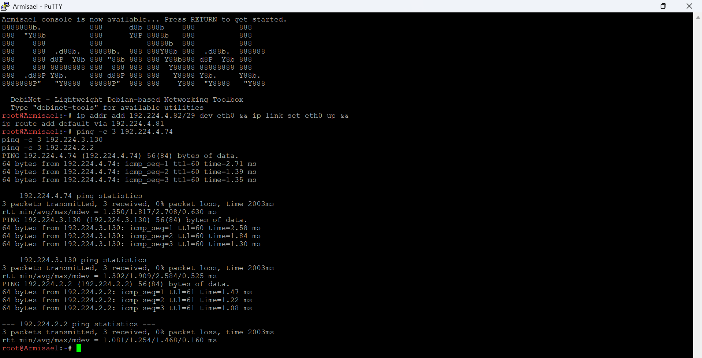


4. Haus kabar dari dunia luar: Maya melapor bahwa semua sistem 
butuh update dari luar, padahal pintu keluarnya hanya Gendo. IP 
dari NAT1 juga bisa berganti kapan saja. Beri seluruh jaringan akses 
internet lewat Gendo. Konfigurasinya tidak boleh perlu diubah saat IP 
NAT1 berganti. Hanya traffic dari prefix internal yang keluar lewat 
NAT1 yang boleh diterjemahkan alamatnya, sedangkan traffic antar
LAN harus tetap membawa alamat asli pengirimnya. Node yang 
nanti memasang paket juga harus bisa me-resolve nama domain. 
Selesaikan sebelum node lain memasang paket. Buktikan ping 
8.8.8.8 dan ping deb.debian.org dari Armisael dan Lilith berhasil, 
dan tunjukkan counter rule NAT.

---

## Soal 4: Haus Kabar dari Dunia Luar (NAT Masquerade & DNS)

> **Soal:**
> 4. Haus kabar dari dunia luar: Maya melapor bahwa semua sistem butuh update dari luar, padahal pintu keluarnya hanya Gendo. IP dari NAT1 juga bisa berganti kapan saja. Beri seluruh jaringan akses internet lewat Gendo. Konfigurasinya tidak boleh perlu diubah saat IP NAT1 berganti. Hanya traffic dari prefix internal yang keluar lewat NAT1 yang boleh diterjemahkan alamatnya, sedangkan traffic antar LAN harus tetap membawa alamat asli pengirimnya. Node yang nanti memasang paket juga harus bisa me-resolve nama domain. Selesaikan sebelum node lain memasang paket. Buktikan ping 8.8.8.8 dan ping deb.debian.org dari Armisael dan Lilith berhasil, dan tunjukkan counter rule NAT.

### Rancangan Solusi

1. **NAT Masquerade hanya di Gendou:**
   ```bash
   iptables -t nat -A POSTROUTING -s 192.224.0.0/16 -o eth0 -j MASQUERADE
   ```
   - **`-j MASQUERADE`**: menerjemahkan IP sumber secara dinamis mengikuti IP `eth0` saat itu, sehingga **tidak perlu diubah** meskipun IP DHCP dari NAT1 berganti.
   - **`-s 192.224.0.0/16 -o eth0`**: hanya traffic dari prefix internal Geofront yang keluar menuju **NAT1 (`eth0`)** yang diterjemahkan. Traffic antar-LAN di dalam `192.224.0.0/16` keluar lewat `eth1`–`eth8`, sehingga **tidak terkena NAT** dan tetap membawa IP asli pengirimnya.
2. **Router lain tidak perlu diubah routing-nya** karena sejak Soal 3 semua 16 router di bawah Gendou sudah memiliki `default route` (`0.0.0.0/0`) mengarah ke atas sampai ke Gendou.
3. **DNS Resolver (`/etc/resolv.conf`):**
   - Agar node dapat me-resolve domain (seperti `deb.debian.org`), tambahkan DNS resolver (`nameserver 8.8.8.8` dan `nameserver 1.1.1.1`) di `/etc/resolv.conf` pada node yang membutuhkan internet/instalasi paket (dan permanen di soal 6 nanti lewat DHCP/config).

### Konfigurasi Baru Gendou

Hanya **Gendou** yang berubah dari konfigurasi Soal 3 (ditambahkan rule `MASQUERADE` pada `eth0`). File lengkap ada di [config/soal4/Gendou.cfg](config/soal4/Gendou.cfg).

<details>
<summary><b>Gendou (Soal 4)</b></summary>

```
# Gendou - /etc/network/interfaces (Soal 4: tambah NAT MASQUERADE)
auto eth0
iface eth0 inet dhcp
    # NAT1 (internet), IP & default route otomatis dari DHCP
    up echo 1 > /proc/sys/net/ipv4/ip_forward
    up iptables -t nat -C POSTROUTING -s 192.224.0.0/16 -o eth0 -j MASQUERADE 2>/dev/null || iptables -t nat -A POSTROUTING -s 192.224.0.0/16 -o eth0 -j MASQUERADE

auto eth1
iface eth1 inet static
    # Link Gendou-Yui
    address 192.224.4.109
    netmask 255.255.255.252

auto eth2
iface eth2 inet static
    # LAN Switch-Cmd (gateway)
    address 192.224.4.105
    netmask 255.255.255.252

auto eth3
iface eth3 inet static
    # Link Gendou-Hikari
    address 192.224.4.113
    netmask 255.255.255.252

auto eth4
iface eth4 inet static
    # Link Gendou-Fuyutsuki
    address 192.224.4.117
    netmask 255.255.255.252

auto eth5
iface eth5 inet static
    # Link Gendou-Asuka
    address 192.224.4.121
    netmask 255.255.255.252

auto eth6
iface eth6 inet static
    # Link Gendou-Kaji
    address 192.224.4.125
    netmask 255.255.255.252

auto eth7
iface eth7 inet static
    # Link Gendou-Misato
    address 192.224.4.129
    netmask 255.255.255.252

auto eth8
iface eth8 inet static
    # Link Gendou-Shigeru
    address 192.224.4.133
    netmask 255.255.255.252
    # Static routes ke cabang bawah
    up ip route replace 192.224.0.0/23 via 192.224.4.110   # Switch-Quarters (via Yui -> Rei)
    up ip route replace 192.224.3.0/25 via 192.224.4.110   # Switch-Hangar (via Yui)
    up ip route replace 192.224.4.0/27 via 192.224.4.110   # Switch-Garden (via Yui -> Shinji)
    up ip route replace 192.224.4.32/28 via 192.224.4.110   # Switch-Dock (via Yui -> Mari)
    up ip route replace 192.224.4.136/29 via 192.224.4.110   # Ringkasan Link Yui-Rei + Yui-Shinji
    up ip route replace 192.224.4.144/30 via 192.224.4.110   # Link Yui-Mari
    up ip route replace 192.224.2.0/24 via 192.224.4.114   # Switch-Comm (via Hikari)
    up ip route replace 192.224.3.224/27 via 192.224.4.114   # Switch-Relay (via Hikari -> Kaworu)
    up ip route replace 192.224.4.148/30 via 192.224.4.114   # Link Hikari-Kaworu
    up ip route replace 192.224.3.192/27 via 192.224.4.118   # Switch-Medic (via Fuyutsuki -> Maya)
    up ip route replace 192.224.4.56/29 via 192.224.4.118   # Switch-Terminal (via Fuyutsuki)
    up ip route replace 192.224.4.72/29 via 192.224.4.118   # Switch-Dogma (via Fuyutsuki -> Toji)
    up ip route replace 192.224.4.152/29 via 192.224.4.118   # Ringkasan Link Fuyutsuki-Maya + Fuyutsuki-Toji
    up ip route replace 192.224.3.128/26 via 192.224.4.122   # Switch-Bunker (via Asuka -> Kensuke)
    up ip route replace 192.224.4.48/29 via 192.224.4.122   # Switch-Lab (via Asuka -> Ritsuko)
    up ip route replace 192.224.4.96/30 via 192.224.4.122   # Switch-Archive (via Asuka)
    up ip route replace 192.224.4.160/29 via 192.224.4.122   # Ringkasan Link Asuka-Kensuke + Asuka-Ritsuko
    up ip route replace 192.224.4.100/30 via 192.224.4.126   # Switch-Intel (via Kaji)
    up ip route replace 192.224.4.64/29 via 192.224.4.130   # Switch-Cage (via Misato)
    up ip route replace 192.224.4.80/28 via 192.224.4.134   # Ringkasan Switch-Monolith + Switch-Radar (via Shigeru)
    up ip route replace 192.224.4.168/30 via 192.224.4.134   # Link Shigeru-Mokoto
```

</details>

### Cara Menguji Soal 4

1. **Di console Gendou:**
   - Pastikan `iptables` terpasang (jika belum ada, jalankan `apt update && apt install -y iptables` — Gendou sudah punya internet dari NAT1).
   - Pasang konfigurasi baru [Gendou.cfg](config/soal4/Gendou.cfg) ke `/etc/network/interfaces` Gendou, lalu **Stop** dan **Start** ulang node Gendou (atau jalankan langsung `iptables -t nat -A POSTROUTING -s 192.224.0.0/16 -o eth0 -j MASQUERADE` agar langsung aktif tanpa restart).
2. **Di console Armisael** (pastikan IP sementara `192.224.4.82/29` dan gateway `192.224.4.81` dari Soal 3 masih terpasang):
   ```bash
   echo -e "nameserver 8.8.8.8\nnameserver 1.1.1.1" > /etc/resolv.conf
   ping -c 3 8.8.8.8
   ping -c 3 deb.debian.org
   ```
3. **Di console Lilith** (pastikan IP sementara `192.224.4.74/29` dan gateway `192.224.4.73` dari Soal 3 masih terpasang):
   ```bash
   echo -e "nameserver 8.8.8.8\nnameserver 1.1.1.1" > /etc/resolv.conf
   ping -c 3 8.8.8.8
   ping -c 3 deb.debian.org
   ```
4. **Cek counter rule NAT di console Gendou:**
   ```bash
   iptables -t nat -L POSTROUTING -n -v
   ```
   Pastikan kolom `pkts` dan `bytes` pada rule `MASQUERADE` (`source 192.224.0.0/16`, `out eth0`) bertambah (> 0).
5. **Catatan untuk router/node lain yang mau install paket (Soal 5 & 6):**
   Setiap router/node yang akan menjalankan `apt update` cukup memiliki DNS di `/etc/resolv.conf` (`echo "nameserver 8.8.8.8" > /etc/resolv.conf`) karena jalur internet via NAT Gendou sudah aktif untuk seluruh `192.224.0.0/16`.

### Hasil Pengujian Soal 4

1. **Armisael** berhasil ping `8.8.8.8` dan `deb.debian.org` (`0% packet loss`):
   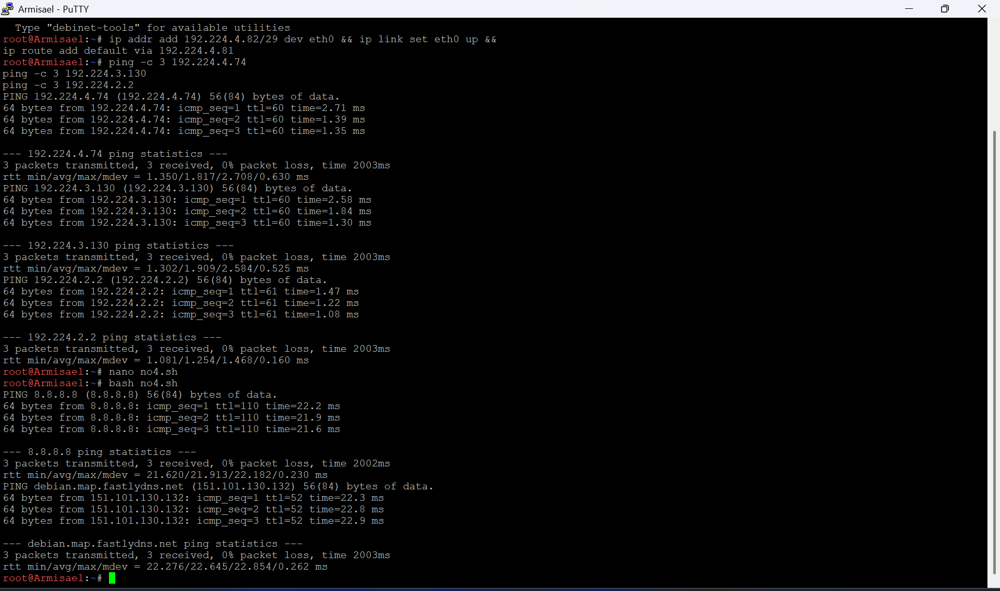
2. **Lilith** berhasil ping `8.8.8.8` dan `deb.debian.org` (`0% packet loss`):
   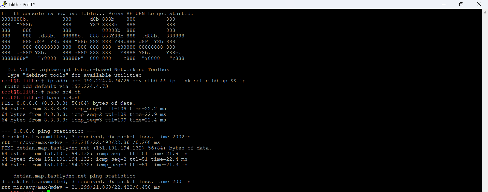
3. **Counter Rule NAT di Gendou** (`iptables -t nat -L POSTROUTING -n -v`) menunjukkan rule `MASQUERADE` untuk `192.224.0.0/16` keluar lewat `eth0` aktif dengan counter `8 pkts / 604 bytes`:
   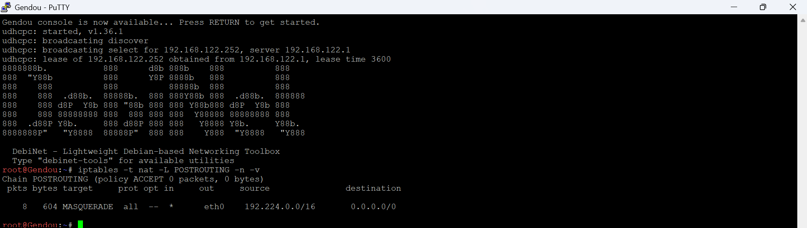

---

## Soal 5: Pintu Depan Dikunci Rapat (Firewall `iptables` di Gendou)

> **Soal:**
> 5. Pintu depan dikunci rapat: Kaji memperingatkan Kaworu bahwa SEELE cukup mengetuk pintu depan. Gendo mengunci NAT1: boleh keluar, tidak boleh dimasuki. Di Gendo, ubah policy INPUT dan FORWARD menjadi DROP. Lalu izinkan empat hal: (a) balasan koneksi yang sudah ada, (b) traffic dari jaringan internal ke internet, (c) traffic antar-LAN, dan (d) traffic dari jaringan internal ke Gendo sendiri. Loopback dan DHCP dari NAT1 juga harus tetap jalan. Koneksi baru dari sisi NAT1 tidak boleh masuk. Soal 2 sampai 4 harus tetap jalan, dan semuanya ditulis di `gendo.sh`. Tunjukkan `iptables -S` di Gendo, dan buktikan `ping 8.8.8.8` dari Armisael masih berhasil.

### Penjelasan Aturan di `gendo.sh`

1. **Soal 2–4 tetap jalan:**
   - `echo 1 > /proc/sys/net/ipv4/ip_forward` menjaga IP forwarding aktif (Soal 2).
   - IP dan static route tetap terpasang lewat `/etc/network/interfaces` (Soal 2 & 3).
   - `iptables -t nat -A POSTROUTING -s 192.224.0.0/16 -o eth0 -j MASQUERADE` menjaga NAT keluar (Soal 4).
2. **Policy default:** `INPUT DROP`, `FORWARD DROP`, `OUTPUT ACCEPT`.
   - Koneksi baru (`NEW`) dari sisi `eth0` (NAT1) tidak ada rule yang mengizinkan, sehingga otomatis di-`DROP`.
3. **Loopback & DHCP NAT1:**
   - `INPUT -i lo -j ACCEPT` agar komunikasi lokal di dalam Gendou tetap berjalan.
   - `INPUT -i eth0 -p udp --sport 67 --dport 68 -j ACCEPT` agar proses DHCP client dari NAT1 pada `eth0` tetap dapat menerima OFFER/ACK.
4. **Empat izin yang diminta:**
   - **(a) Balasan koneksi yang sudah ada:** `INPUT` dan `FORWARD` dengan `-m conntrack --ctstate ESTABLISHED,RELATED -j ACCEPT`.
   - **(b) Traffic internal ke internet:** `FORWARD ! -i eth0 -s 192.224.0.0/16 -o eth0 -j ACCEPT`.
   - **(c) Traffic antar-LAN:** `FORWARD ! -i eth0 -s 192.224.0.0/16 -d 192.224.0.0/16 -j ACCEPT`.
   - **(d) Traffic internal ke Gendou sendiri:** `INPUT ! -i eth0 -s 192.224.0.0/16 -j ACCEPT`.
   - Penggunaan `! -i eth0` memastikan paket ber-IP internal palsu (spoofing) yang masuk dari arah NAT1 (`eth0`) tidak akan diterima.

### Isi Script `gendo.sh`

File juga tersedia di [config/soal5/gendo.sh](config/soal5/gendo.sh).

```bash
#!/bin/bash
# gendo.sh - Firewall & NAT Gendou (Soal 2-5)

# Pastikan IP forwarding aktif (Soal 2)
echo 1 > /proc/sys/net/ipv4/ip_forward

# Reset semua chain agar tidak duplikat saat dijalankan ulang
iptables -F
iptables -X
iptables -t nat -F

# Policy default OUTPUT ACCEPT, INPUT & FORWARD DROP (Soal 5)
iptables -P INPUT DROP
iptables -P FORWARD DROP
iptables -P OUTPUT ACCEPT

# NAT Masquerade untuk traffic internal keluar ke NAT1 / eth0 (Soal 4)
iptables -t nat -A POSTROUTING -s 192.224.0.0/16 -o eth0 -j MASQUERADE

# Loopback dan DHCP dari NAT1 (eth0) tetap jalan
iptables -A INPUT -i lo -j ACCEPT
iptables -A INPUT -i eth0 -p udp --sport 67 --dport 68 -j ACCEPT

# (a) Balasan koneksi yang sudah ada (ESTABLISHED, RELATED)
iptables -A INPUT -m conntrack --ctstate ESTABLISHED,RELATED -j ACCEPT
iptables -A FORWARD -m conntrack --ctstate ESTABLISHED,RELATED -j ACCEPT

# (d) Traffic dari jaringan internal ke Gendou sendiri
iptables -A INPUT ! -i eth0 -s 192.224.0.0/16 -j ACCEPT

# (b) Traffic dari jaringan internal ke internet (keluar lewat eth0)
iptables -A FORWARD ! -i eth0 -s 192.224.0.0/16 -o eth0 -j ACCEPT

# (c) Traffic antar-LAN di dalam jaringan internal
iptables -A FORWARD ! -i eth0 -s 192.224.0.0/16 -d 192.224.0.0/16 -j ACCEPT
```

### Cara Menguji Soal 5

1. **Di console Gendou**, buat dan jalankan `gendo.sh`:
   ```bash
   nano /root/gendo.sh
   # tempel isi script di atas, simpan
   chmod +x /root/gendo.sh
   bash /root/gendo.sh
   ```
   *(Opsional agar otomatis aktif setiap Gendou restart: tambahkan baris `up /root/gendo.sh` di paling bawah stanza `eth8` pada `/etc/network/interfaces` Gendou.)*
2. **Tampilkan aturan firewall di Gendou:**
   ```bash
   iptables -S
   ```
   Pastikan terlihat `-P INPUT DROP`, `-P FORWARD DROP`, `-P OUTPUT ACCEPT`, beserta semua rule di atas.
3. **Di console Armisael** (IP sementara `192.224.4.82/29`, gateway `192.224.4.81`):
   ```bash
   ping -c 3 8.8.8.8
   ping -c 3 192.224.4.74    # pastikan antar-LAN (ke Lilith) masih jalan
   ping -c 3 192.224.4.109   # pastikan ke Gendou sendiri masih jalan
   ```
   Semua ping harus berhasil (`0% packet loss`).

### Hasil Pengujian Soal 5

1. **`iptables -S` di Gendou:**
   ```
   -P INPUT DROP
   -P FORWARD DROP
   -P OUTPUT ACCEPT
   -A INPUT -i lo -j ACCEPT
   -A INPUT -i eth0 -p udp -m udp --sport 67 --dport 68 -j ACCEPT
   -A INPUT -m conntrack --ctstate RELATED,ESTABLISHED -j ACCEPT
   -A INPUT -s 192.224.0.0/16 ! -i eth0 -j ACCEPT
   -A FORWARD -m conntrack --ctstate RELATED,ESTABLISHED -j ACCEPT
   -A FORWARD -s 192.224.0.0/16 ! -i eth0 -o eth0 -j ACCEPT
   -A FORWARD -s 192.224.0.0/16 -d 192.224.0.0/16 ! -i eth0 -j ACCEPT
   ```
2. **Ping dari Armisael** ke `8.8.8.8`, Lilith (`192.224.4.74`), dan Gendou (`192.224.4.109`) tetap berhasil (`0% packet loss`):
   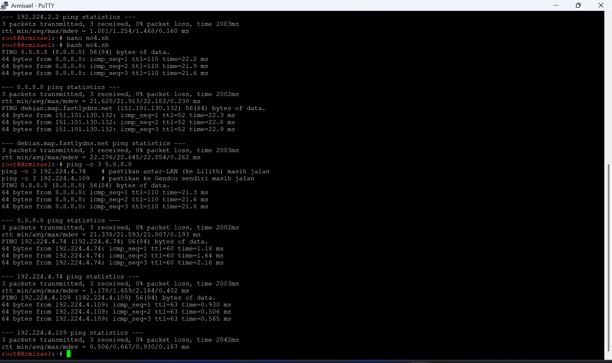

---

## Soal 6: Alamat Para Pilot (IP Statis Permanen Semua Node Non-Router)

> **Soal:**
> 6. Alamat para pilot: jaringan sudah hidup, tapi para pilot dan staf tidak tahu alamat mereka sendiri. Unit-01 bahkan tidak tahu siapa gateway-nya. Beri IP statis dan gateway ke semua node non-router, sesuai aturan alamat di glosarium. Simpan agar bertahan setelah restart. Tunjukkan `ip -br` dan ping ke gateway di Unit-01.

### Aturan Pengalamatan

- **Gateway LAN** = IP usable pertama di subnet masing-masing (sudah terpasang di router).
- **Host / node non-router** mendapat IP usable berikutnya secara berurutan sesuai daftar pada Tabel Host (gateway + 1, gateway + 2, dst.).
- Konfigurasi disimpan di /etc/network/interfaces (**Configure → Edit network configuration** pada tiap node di GNS3) agar **bertahan setelah restart**.
- Baris up echo "nameserver 8.8.8.8" > /etc/resolv.conf juga disertakan agar DNS ikut bertahan setelah restart.
- *(Catatan: pada Soal 3–5, Armisael sempat diberi IP sementara .82. Untuk IP permanen di Soal 6 sesuai urutan Tabel Host, Zeruel mendapat 192.224.4.82/29 dan Armisael mendapat 192.224.4.83/29. Jika Armisael belum di-restart, hapus IP sementara dulu atau langsung **Stop → Start** node-nya.)*

### Tabel Alamat Semua Node Non-Router

| No | Node | Switch | Router Gateway | IP / Prefix | Netmask | Gateway |
|---:|---|---|---|---|---|---|
| 1 | **Quarters** | Switch-Quarters | Rei | `192.224.0.2/23` | `255.255.254.0` | `192.224.0.1` |
| 2 | **Comm-Net** | Switch-Comm | Hikari | `192.224.2.2/24` | `255.255.255.0` | `192.224.2.1` |
| 3 | **Hangar-Crew** | Switch-Hangar | Yui | `192.224.3.2/25` | `255.255.255.128` | `192.224.3.1` |
| 4 | **Sachiel** | Switch-Bunker | Kensuke | `192.224.3.130/26` | `255.255.255.192` | `192.224.3.129` |
| 5 | **Pen-Pen** | Switch-Medic | Maya | `192.224.3.194/27` | `255.255.255.224` | `192.224.3.193` |
| 6 | **Medic-Bay** | Switch-Medic | Maya | `192.224.3.195/27` | `255.255.255.224` | `192.224.3.193` |
| 7 | **Relay-Node** | Switch-Relay | Kaworu | `192.224.3.226/27` | `255.255.255.224` | `192.224.3.225` |
| 8 | **Garden-Staff** | Switch-Garden | Shinji | `192.224.4.2/27` | `255.255.255.224` | `192.224.4.1` |
| 9 | **Dock-Crew** | Switch-Dock | Mari | `192.224.4.34/28` | `255.255.255.240` | `192.224.4.33` |
| 10 | **Entry-Plug** | Switch-Lab | Ritsuko | `192.224.4.50/29` | `255.255.255.248` | `192.224.4.49` |
| 11 | **Dummy-Plug** | Switch-Lab | Ritsuko | `192.224.4.51/29` | `255.255.255.248` | `192.224.4.49` |
| 12 | **Magi-Casper** | Switch-Terminal | Fuyutsuki | `192.224.4.58/29` | `255.255.255.248` | `192.224.4.57` |
| 13 | **Magi-Balthasar** | Switch-Terminal | Fuyutsuki | `192.224.4.59/29` | `255.255.255.248` | `192.224.4.57` |
| 14 | **Magi-Melchior** | Switch-Terminal | Fuyutsuki | `192.224.4.60/29` | `255.255.255.248` | `192.224.4.57` |
| 15 | **Unit-01** | Switch-Cage | Misato | `192.224.4.66/29` | `255.255.255.248` | `192.224.4.65` |
| 16 | **Unit-02** | Switch-Cage | Misato | `192.224.4.67/29` | `255.255.255.248` | `192.224.4.65` |
| 17 | **Unit-00** | Switch-Cage | Misato | `192.224.4.68/29` | `255.255.255.248` | `192.224.4.65` |
| 18 | **Lilith** | Switch-Dogma | Toji | `192.224.4.74/29` | `255.255.255.248` | `192.224.4.73` |
| 19 | **Adam** | Switch-Dogma | Toji | `192.224.4.75/29` | `255.255.255.248` | `192.224.4.73` |
| 20 | **Zeruel** | Switch-Monolith | Shigeru | `192.224.4.82/29` | `255.255.255.248` | `192.224.4.81` |
| 21 | **Armisael** | Switch-Monolith | Shigeru | `192.224.4.83/29` | `255.255.255.248` | `192.224.4.81` |
| 22 | **Radar-Array** | Switch-Radar | Mokoto | `192.224.4.90/29` | `255.255.255.248` | `192.224.4.89` |
| 23 | **Archive-Vault** | Switch-Archive | Asuka | `192.224.4.98/30` | `255.255.255.252` | `192.224.4.97` |
| 24 | **Spy** | Switch-Intel | Kaji | `192.224.4.102/30` | `255.255.255.252` | `192.224.4.101` |
| 25 | **Tokyo3-Core** | Switch-Cmd | Gendou | `192.224.4.106/30` | `255.255.255.252` | `192.224.4.105` |

### Konfigurasi /etc/network/interfaces Tiap Node

Tempel ke menu **Configure → Edit network configuration** di tiap node container GNS3, lalu **Stop** dan **Start** ulang node. File lengkap juga ada di folder [config/soal6](config/soal6).

<details>
<summary><b>Quarters</b> (<code>192.224.0.2/23</code>, gw <code>192.224.0.1</code>)</summary>

```
# Quarters - /etc/network/interfaces (Soal 6)
auto eth0
iface eth0 inet static
    # Switch-Quarters (gateway Rei)
    address 192.224.0.2
    netmask 255.255.254.0
    gateway 192.224.0.1
    up echo "nameserver 8.8.8.8" > /etc/resolv.conf
```

</details>

<details>
<summary><b>Comm-Net</b> (<code>192.224.2.2/24</code>, gw <code>192.224.2.1</code>)</summary>

```
# Comm-Net - /etc/network/interfaces (Soal 6)
auto eth0
iface eth0 inet static
    # Switch-Comm (gateway Hikari)
    address 192.224.2.2
    netmask 255.255.255.0
    gateway 192.224.2.1
    up echo "nameserver 8.8.8.8" > /etc/resolv.conf
```

</details>

<details>
<summary><b>Hangar-Crew</b> (<code>192.224.3.2/25</code>, gw <code>192.224.3.1</code>)</summary>

```
# Hangar-Crew - /etc/network/interfaces (Soal 6)
auto eth0
iface eth0 inet static
    # Switch-Hangar (gateway Yui)
    address 192.224.3.2
    netmask 255.255.255.128
    gateway 192.224.3.1
    up echo "nameserver 8.8.8.8" > /etc/resolv.conf
```

</details>

<details>
<summary><b>Sachiel</b> (<code>192.224.3.130/26</code>, gw <code>192.224.3.129</code>)</summary>

```
# Sachiel - /etc/network/interfaces (Soal 6)
auto eth0
iface eth0 inet static
    # Switch-Bunker (gateway Kensuke)
    address 192.224.3.130
    netmask 255.255.255.192
    gateway 192.224.3.129
    up echo "nameserver 8.8.8.8" > /etc/resolv.conf
```

</details>

<details>
<summary><b>Pen-Pen</b> (<code>192.224.3.194/27</code>, gw <code>192.224.3.193</code>)</summary>

```
# Pen-Pen - /etc/network/interfaces (Soal 6)
auto eth0
iface eth0 inet static
    # Switch-Medic (gateway Maya)
    address 192.224.3.194
    netmask 255.255.255.224
    gateway 192.224.3.193
    up echo "nameserver 8.8.8.8" > /etc/resolv.conf
```

</details>

<details>
<summary><b>Medic-Bay</b> (<code>192.224.3.195/27</code>, gw <code>192.224.3.193</code>)</summary>

```
# Medic-Bay - /etc/network/interfaces (Soal 6)
auto eth0
iface eth0 inet static
    # Switch-Medic (gateway Maya)
    address 192.224.3.195
    netmask 255.255.255.224
    gateway 192.224.3.193
    up echo "nameserver 8.8.8.8" > /etc/resolv.conf
```

</details>

<details>
<summary><b>Relay-Node</b> (<code>192.224.3.226/27</code>, gw <code>192.224.3.225</code>)</summary>

```
# Relay-Node - /etc/network/interfaces (Soal 6)
auto eth0
iface eth0 inet static
    # Switch-Relay (gateway Kaworu)
    address 192.224.3.226
    netmask 255.255.255.224
    gateway 192.224.3.225
    up echo "nameserver 8.8.8.8" > /etc/resolv.conf
```

</details>

<details>
<summary><b>Garden-Staff</b> (<code>192.224.4.2/27</code>, gw <code>192.224.4.1</code>)</summary>

```
# Garden-Staff - /etc/network/interfaces (Soal 6)
auto eth0
iface eth0 inet static
    # Switch-Garden (gateway Shinji)
    address 192.224.4.2
    netmask 255.255.255.224
    gateway 192.224.4.1
    up echo "nameserver 8.8.8.8" > /etc/resolv.conf
```

</details>

<details>
<summary><b>Dock-Crew</b> (<code>192.224.4.34/28</code>, gw <code>192.224.4.33</code>)</summary>

```
# Dock-Crew - /etc/network/interfaces (Soal 6)
auto eth0
iface eth0 inet static
    # Switch-Dock (gateway Mari)
    address 192.224.4.34
    netmask 255.255.255.240
    gateway 192.224.4.33
    up echo "nameserver 8.8.8.8" > /etc/resolv.conf
```

</details>

<details>
<summary><b>Entry-Plug</b> (<code>192.224.4.50/29</code>, gw <code>192.224.4.49</code>)</summary>

```
# Entry-Plug - /etc/network/interfaces (Soal 6)
auto eth0
iface eth0 inet static
    # Switch-Lab (gateway Ritsuko)
    address 192.224.4.50
    netmask 255.255.255.248
    gateway 192.224.4.49
    up echo "nameserver 8.8.8.8" > /etc/resolv.conf
```

</details>

<details>
<summary><b>Dummy-Plug</b> (<code>192.224.4.51/29</code>, gw <code>192.224.4.49</code>)</summary>

```
# Dummy-Plug - /etc/network/interfaces (Soal 6)
auto eth0
iface eth0 inet static
    # Switch-Lab (gateway Ritsuko)
    address 192.224.4.51
    netmask 255.255.255.248
    gateway 192.224.4.49
    up echo "nameserver 8.8.8.8" > /etc/resolv.conf
```

</details>

<details>
<summary><b>Magi-Casper</b> (<code>192.224.4.58/29</code>, gw <code>192.224.4.57</code>)</summary>

```
# Magi-Casper - /etc/network/interfaces (Soal 6)
auto eth0
iface eth0 inet static
    # Switch-Terminal (gateway Fuyutsuki)
    address 192.224.4.58
    netmask 255.255.255.248
    gateway 192.224.4.57
    up echo "nameserver 8.8.8.8" > /etc/resolv.conf
```

</details>

<details>
<summary><b>Magi-Balthasar</b> (<code>192.224.4.59/29</code>, gw <code>192.224.4.57</code>)</summary>

```
# Magi-Balthasar - /etc/network/interfaces (Soal 6)
auto eth0
iface eth0 inet static
    # Switch-Terminal (gateway Fuyutsuki)
    address 192.224.4.59
    netmask 255.255.255.248
    gateway 192.224.4.57
    up echo "nameserver 8.8.8.8" > /etc/resolv.conf
```

</details>

<details>
<summary><b>Magi-Melchior</b> (<code>192.224.4.60/29</code>, gw <code>192.224.4.57</code>)</summary>

```
# Magi-Melchior - /etc/network/interfaces (Soal 6)
auto eth0
iface eth0 inet static
    # Switch-Terminal (gateway Fuyutsuki)
    address 192.224.4.60
    netmask 255.255.255.248
    gateway 192.224.4.57
    up echo "nameserver 8.8.8.8" > /etc/resolv.conf
```

</details>

<details>
<summary><b>Unit-01</b> (<code>192.224.4.66/29</code>, gw <code>192.224.4.65</code>)</summary>

```
# Unit-01 - /etc/network/interfaces (Soal 6)
auto eth0
iface eth0 inet static
    # Switch-Cage (gateway Misato)
    address 192.224.4.66
    netmask 255.255.255.248
    gateway 192.224.4.65
    up echo "nameserver 8.8.8.8" > /etc/resolv.conf
```

</details>

<details>
<summary><b>Unit-02</b> (<code>192.224.4.67/29</code>, gw <code>192.224.4.65</code>)</summary>

```
# Unit-02 - /etc/network/interfaces (Soal 6)
auto eth0
iface eth0 inet static
    # Switch-Cage (gateway Misato)
    address 192.224.4.67
    netmask 255.255.255.248
    gateway 192.224.4.65
    up echo "nameserver 8.8.8.8" > /etc/resolv.conf
```

</details>

<details>
<summary><b>Unit-00</b> (<code>192.224.4.68/29</code>, gw <code>192.224.4.65</code>)</summary>

```
# Unit-00 - /etc/network/interfaces (Soal 6)
auto eth0
iface eth0 inet static
    # Switch-Cage (gateway Misato)
    address 192.224.4.68
    netmask 255.255.255.248
    gateway 192.224.4.65
    up echo "nameserver 8.8.8.8" > /etc/resolv.conf
```

</details>

<details>
<summary><b>Lilith</b> (<code>192.224.4.74/29</code>, gw <code>192.224.4.73</code>)</summary>

```
# Lilith - /etc/network/interfaces (Soal 6)
auto eth0
iface eth0 inet static
    # Switch-Dogma (gateway Toji)
    address 192.224.4.74
    netmask 255.255.255.248
    gateway 192.224.4.73
    up echo "nameserver 8.8.8.8" > /etc/resolv.conf
```

</details>

<details>
<summary><b>Adam</b> (<code>192.224.4.75/29</code>, gw <code>192.224.4.73</code>)</summary>

```
# Adam - /etc/network/interfaces (Soal 6)
auto eth0
iface eth0 inet static
    # Switch-Dogma (gateway Toji)
    address 192.224.4.75
    netmask 255.255.255.248
    gateway 192.224.4.73
    up echo "nameserver 8.8.8.8" > /etc/resolv.conf
```

</details>

<details>
<summary><b>Zeruel</b> (<code>192.224.4.82/29</code>, gw <code>192.224.4.81</code>)</summary>

```
# Zeruel - /etc/network/interfaces (Soal 6)
auto eth0
iface eth0 inet static
    # Switch-Monolith (gateway Shigeru)
    address 192.224.4.82
    netmask 255.255.255.248
    gateway 192.224.4.81
    up echo "nameserver 8.8.8.8" > /etc/resolv.conf
```

</details>

<details>
<summary><b>Armisael</b> (<code>192.224.4.83/29</code>, gw <code>192.224.4.81</code>)</summary>

```
# Armisael - /etc/network/interfaces (Soal 6)
auto eth0
iface eth0 inet static
    # Switch-Monolith (gateway Shigeru)
    address 192.224.4.83
    netmask 255.255.255.248
    gateway 192.224.4.81
    up echo "nameserver 8.8.8.8" > /etc/resolv.conf
```

</details>

<details>
<summary><b>Radar-Array</b> (<code>192.224.4.90/29</code>, gw <code>192.224.4.89</code>)</summary>

```
# Radar-Array - /etc/network/interfaces (Soal 6)
auto eth0
iface eth0 inet static
    # Switch-Radar (gateway Mokoto)
    address 192.224.4.90
    netmask 255.255.255.248
    gateway 192.224.4.89
    up echo "nameserver 8.8.8.8" > /etc/resolv.conf
```

</details>

<details>
<summary><b>Archive-Vault</b> (<code>192.224.4.98/30</code>, gw <code>192.224.4.97</code>)</summary>

```
# Archive-Vault - /etc/network/interfaces (Soal 6)
auto eth0
iface eth0 inet static
    # Switch-Archive (gateway Asuka)
    address 192.224.4.98
    netmask 255.255.255.252
    gateway 192.224.4.97
    up echo "nameserver 8.8.8.8" > /etc/resolv.conf
```

</details>

<details>
<summary><b>Spy</b> (<code>192.224.4.102/30</code>, gw <code>192.224.4.101</code>)</summary>

```
# Spy - /etc/network/interfaces (Soal 6)
auto eth0
iface eth0 inet static
    # Switch-Intel (gateway Kaji)
    address 192.224.4.102
    netmask 255.255.255.252
    gateway 192.224.4.101
    up echo "nameserver 8.8.8.8" > /etc/resolv.conf
```

</details>

<details>
<summary><b>Tokyo3-Core</b> (<code>192.224.4.106/30</code>, gw <code>192.224.4.105</code>)</summary>

```
# Tokyo3-Core - /etc/network/interfaces (Soal 6)
auto eth0
iface eth0 inet static
    # Switch-Cmd (gateway Gendou)
    address 192.224.4.106
    netmask 255.255.255.252
    gateway 192.224.4.105
    up echo "nameserver 8.8.8.8" > /etc/resolv.conf
```

</details>

### Cara Menguji Soal 6

1. Pasang konfigurasi di atas ke **Configure → Edit network configuration** pada seluruh node non-router.
2. **Stop** lalu **Start** ulang node-node tersebut (minimal wajib restart **Unit-01** untuk membuktikan konfigurasi bertahan setelah restart).
3. Buka console **Unit-01** (di topologi bernama Unit-01, switch Switch-Cage, gateway Misato 192.224.4.65), lalu jalankan:
   ```bash
   ip -br a
   ping -c 3 192.224.4.65
   ```
   - eth0 pada Unit-01 harus menampilkan 192.224.4.66/29.
   - ping -c 3 192.224.4.65 (ke gateway Misato) harus berhasil dengan 0% packet loss.
4. Untuk memastikan bertahan setelah restart, klik **Stop** pada **Unit-01**, **Start** lagi, lalu ulangi ip -br a dan ping -c 3 192.224.4.65.

### Hasil Pengujian Soal 6

`Unit-01` menampilkan IP statis `192.224.4.66/29` pada `eth0` dan berhasil `ping` ke gateway Misato (`192.224.4.65`) dengan `0% packet loss`:

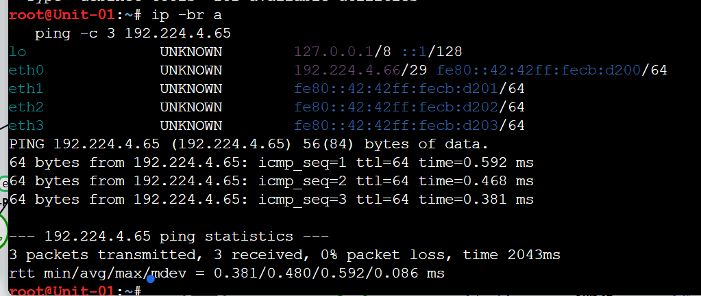

---

## Soal 7: Membangunkan MAGI (Casper, Balthasar, Melchior)

> **Soal:**
> 7. Membangunkan MAGI: Casper, Balthasar, dan Melchior di Switch Terminal menunggu diaktifkan. Ritsuko ingin ketiganya melayani dulu, urusan keamanan dibahas nanti. Pasang `iptables` dan `netcat-traditional` lewat `/root/<nama>.sh`, lalu nyalakan listener sesuai port di glosarium. Dari Lilith, kirim pesan ke ketiganya dan ke port 5001 Balthasar. Tampilkan pesan yang diterima di tiap node.

### Port & IP Perangkat MAGI

| Node | IP | Port TCP (Glosarium) | Script |
|---|---|---|---|
| **Magi-Casper** | `192.224.4.58` | `5000` | `/root/casper.sh` ([casper.sh](config/soal7/casper.sh)) |
| **Magi-Balthasar** | `192.224.4.59` | `5000` dan `5001` | `/root/balthasar.sh` ([balthasar.sh](config/soal7/balthasar.sh)) |
| **Magi-Melchior** | `192.224.4.60` | `5000` | `/root/melchior.sh` ([melchior.sh](config/soal7/melchior.sh)) |

### Script Tiap Node

#### 1. `/root/casper.sh` (di Magi-Casper)
```bash
#!/bin/bash
# casper.sh - Pastikan jaringan & DNS aktif, pasang paket, lalu jalankan listener (port 5000)

ip addr replace 192.224.4.58/29 dev eth0
ip link set eth0 up
ip route replace default via 192.224.4.57
echo -e "nameserver 8.8.8.8\nnameserver 1.1.1.1" > /etc/resolv.conf

apt-get update
apt-get install -y iptables netcat-traditional

echo "Magi-Casper listening on TCP port 5000..."
while true; do
    nc.traditional -l -p 5000 | tee -a /root/casper.log
done
```

#### 2. `/root/balthasar.sh` (di Magi-Balthasar)
```bash
#!/bin/bash
# balthasar.sh - Pastikan jaringan & DNS aktif, pasang paket, lalu jalankan listener (port 5000 & 5001)

ip addr replace 192.224.4.59/29 dev eth0
ip link set eth0 up
ip route replace default via 192.224.4.57
echo -e "nameserver 8.8.8.8\nnameserver 1.1.1.1" > /etc/resolv.conf

apt-get update
apt-get install -y iptables netcat-traditional

echo "Magi-Balthasar listening on TCP port 5000 and 5001..."
(while true; do nc.traditional -l -p 5000 | tee -a /root/balthasar_5000.log; done) &
(while true; do nc.traditional -l -p 5001 | tee -a /root/balthasar_5001.log; done) &
wait
```

#### 3. `/root/melchior.sh` (di Magi-Melchior)
```bash
#!/bin/bash
# melchior.sh - Pastikan jaringan & DNS aktif, pasang paket, lalu jalankan listener (port 5000)

ip addr replace 192.224.4.60/29 dev eth0
ip link set eth0 up
ip route replace default via 192.224.4.57
echo -e "nameserver 8.8.8.8\nnameserver 1.1.1.1" > /etc/resolv.conf

apt-get update
apt-get install -y iptables netcat-traditional

echo "Magi-Melchior listening on TCP port 5000..."
while true; do
    nc.traditional -l -p 5000 | tee -a /root/melchior.log
done
```

### Cara Menguji Soal 7

1. Pastikan **Magi-Casper**, **Magi-Balthasar**, **Magi-Melchior**, dan **Lilith** sudah memakai konfigurasi IP statis Soal 6 (`192.224.4.58`, `.59`, `.60`, dan `.74`) beserta DNS `/etc/resolv.conf`.
2. Di console masing-masing node MAGI, buat `/root/casper.sh`, `/root/balthasar.sh`, dan `/root/melchior.sh`, beri izin eksekusi, lalu jalankan (biarkan terminal tetap berjalan sebagai listener):
   ```bash
   chmod +x /root/casper.sh && bash /root/casper.sh         # di Magi-Casper
   chmod +x /root/balthasar.sh && bash /root/balthasar.sh   # di Magi-Balthasar
   chmod +x /root/melchior.sh && bash /root/melchior.sh     # di Magi-Melchior
   ```
3. Dari console **Lilith** (`192.224.4.74`), kirim pesan ke ketiganya dan ke port `5001` Balthasar:
   ```bash
   echo "Halo Casper dari Lilith" | nc -w 1 192.224.4.58 5000
   echo "Halo Balthasar 5000 dari Lilith" | nc -w 1 192.224.4.59 5000
   echo "Halo Balthasar 5001 dari Lilith" | nc -w 1 192.224.4.59 5001
   echo "Halo Melchior dari Lilith" | nc -w 1 192.224.4.60 5000
   ```
4. Cek console **Magi-Casper**, **Magi-Balthasar**, dan **Magi-Melchior** — pesan dari Lilith akan langsung tampil di layar (dan juga tersimpan di `/root/*.log`). Screenshot keempat console tersebut untuk laporan.

### Hasil Pengujian Soal 7

Pengiriman pesan dari **Lilith** ke Magi-Casper (`5000`), Magi-Balthasar (`5000` & `5001`), dan Magi-Melchior (`5000`) berhasil diterima di tiap node:

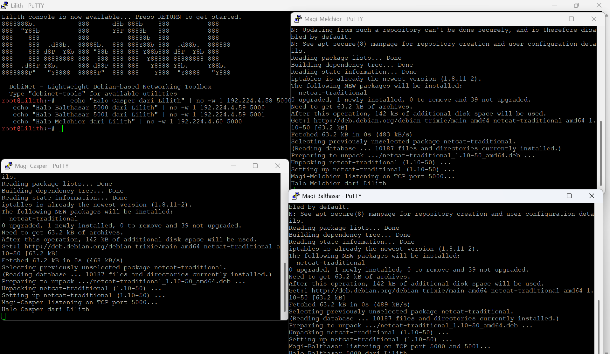

---

## Soal 8: Mengenali Kondisi Normal (Pen-Pen & Tokyo3-Core)

> **Soal:**
> 8. Mengenali kondisi normal: Pen-Pen dan Tokyo3-Core sudah ditandai sebagai calon sasaran pertama SEELE. Sebelum dilindungi, keduanya harus melayani dulu agar kamu tahu kondisi normalnya. Koneksi ke port 80 dijawab `Welcome to {hostname}`. Koneksi ke port 8080 di Tokyo3-Core dijawab `syifa imutz`. Tunjukkan `nc` dari Lilith ke ketiga port itu. Tunjukkan juga bahwa port yang tidak dilayani, misalnya 22, langsung gagal, bukan menggantung.

### Target Layanan

| Node | IP | Port TCP | Balasan | Script |
|---|---|---|---|---|
| **Pen-Pen** | `192.224.3.194` | `80` | `Welcome to Pen-Pen` | `/root/penpen.sh` ([penpen.sh](config/soal8/penpen.sh)) |
| **Tokyo3-Core** | `192.224.4.106` | `80` | `Welcome to Tokyo3-Core` | `/root/tokyo3.sh` ([tokyo3.sh](config/soal8/tokyo3.sh)) |
| **Tokyo3-Core** | `192.224.4.106` | `8080` | `syifa imutz` | `/root/tokyo3.sh` ([tokyo3.sh](config/soal8/tokyo3.sh)) |

### Script Tiap Node

#### 1. `/root/penpen.sh` (di Pen-Pen)
```bash
#!/bin/bash
# penpen.sh - Pasang paket & jalankan listener Pen-Pen di TCP port 80

ip addr replace 192.224.3.194/27 dev eth0
ip link set eth0 up
ip route replace default via 192.224.3.193
echo -e "nameserver 8.8.8.8\nnameserver 1.1.1.1" > /etc/resolv.conf

apt-get update
apt-get install -y iptables netcat-traditional

echo "Pen-Pen listening on TCP port 80..."
while true; do
    echo "Welcome to $(hostname)" | nc.traditional -l -p 80 -q 0
done
```

#### 2. `/root/tokyo3.sh` (di Tokyo3-Core)
```bash
#!/bin/bash
# tokyo3.sh - Pasang paket & jalankan listener Tokyo3-Core di TCP port 80 & 8080

ip addr replace 192.224.4.106/30 dev eth0
ip link set eth0 up
ip route replace default via 192.224.4.105
echo -e "nameserver 8.8.8.8\nnameserver 1.1.1.1" > /etc/resolv.conf

apt-get update
apt-get install -y iptables netcat-traditional

echo "Tokyo3-Core listening on TCP port 80 and 8080..."
(while true; do echo "Welcome to $(hostname)" | nc.traditional -l -p 80 -q 0; done) &
(while true; do echo "syifa imutz" | nc.traditional -l -p 8080 -q 0; done) &
wait
```

*(Opsi `-q 0` pada `nc.traditional` memastikan koneksi langsung ditutup setelah balasan dikirim, sehingga client `nc` tidak menggantung.)*

### Cara Menguji Soal 8

1. Di console **Pen-Pen** dan **Tokyo3-Core**, jalankan script masing-masing (biarkan tetap berjalan):
   ```bash
   bash /root/penpen.sh   # di Pen-Pen
   bash /root/tokyo3.sh   # di Tokyo3-Core
   ```
2. Dari console **Lilith** (`192.224.4.74`), uji ketiga port yang dilayani:
   ```bash
   nc 192.224.3.194 80
   nc 192.224.4.106 80
   nc 192.224.4.106 8080
   ```
   Output yang harus muncul berturut-turut:
   - `Welcome to Pen-Pen`
   - `Welcome to Tokyo3-Core`
   - `syifa imutz`
3. Uji port yang tidak dilayani (misal port `22`) dengan `time` dan exit code `$?` (karena `nc` versi busybox tidak mencetak pesan error):
   ```bash
   time nc -v 192.224.3.194 22; echo "exit=$?"
   time nc -v 192.224.4.106 22; echo "exit=$?"
   ```
   Keduanya harus **langsung gagal** dalam hitungan milidetik (`real 0m0.00Xs`, `exit=1`) karena kernel langsung membalas TCP RST, bukan menggantung.

### Hasil Pengujian Soal 8

Dari console **Lilith**, koneksi `nc` ke Pen-Pen (`80`) dan Tokyo3-Core (`80` & `8080`) menjawab sesuai ketentuan, sedangkan koneksi ke port `22` langsung gagal (`Connection refused`, `0.006–0.007s`, `exit=1`) tanpa menggantung:

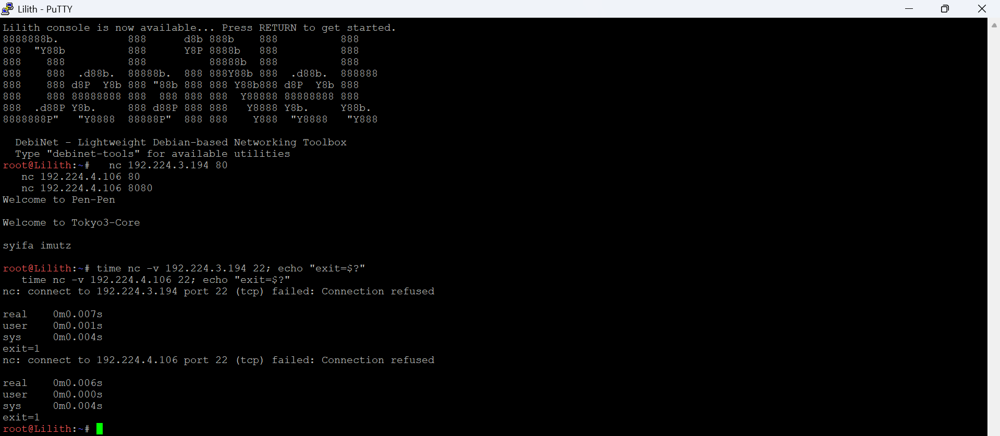

---

## Soal 9: Sabotase Jalur Belakang (`break_routing.sh` di Shigeru)

> **Soal:**
> 9. Jalur belakang diutak-atik: tengah malam masuk laporan bahwa ada yang mengutak-atik jalur belakang di sekitar Shigeru. Lilith tidak mendapat jawaban dari Armisael, padahal Armisael masih bisa ping gateway-nya sendiri. Jalankan `break_routing.sh` di Shigeru. Buktikan Lilith bisa ping Armisael kembali setelah perbaikan.

### Penyebab yang Ditemukan (4 Penyebab)

Setelah menjalankan `bash break_routing.sh` di **Shigeru**, ditemukan **4 masalah** sekaligus:

1. **`ip_forward` dinonaktifkan (`0`):**
   `cat /proc/sys/net/ipv4/ip_forward` bernilai `0`, sehingga Shigeru menolak meneruskan paket lintas interface (`eth0` ↔ `eth1`). Armisael masih bisa ping gateway-nya (`192.224.4.81`) karena tujuan paket adalah Shigeru sendiri (`INPUT`), bukan diteruskan (`FORWARD`).
2. **`default route` dibelokkan ke Mokoto (`192.224.4.170 dev eth2`):**
   Seharusnya default route Shigeru mengarah ke atas (**Gendou `192.224.4.133 dev eth0`**), bukan ke router daun di bawahnya (Mokoto). Selain itu, rute ke bawah untuk Switch-Radar (`192.224.4.88/29 via 192.224.4.170`) juga hilang.
3. **Ada rute `blackhole 192.224.4.72/29`:**
   Subnet `192.224.4.72/29` adalah subnet **Switch-Dogma** (tempat **Lilith** berada). Karena `/29` lebih spesifik dari `default`, semua paket dari Shigeru menuju Lilith langsung dibuang diam-diam (**blackhole**).
4. **Ada policy routing rule `90: from all iif eth1 lookup 100` dengan isi `table 100` berupa `unreachable default`:**
   Semua paket balasan dari **Armisael** yang masuk lewat `eth1` (Switch-Monolith) lebih dulu diarahkan ke `table 100` (sebelum `main` pada prioritas `32766`) lalu dibuang sebagai `unreachable default`. Sementara ping Armisael → `192.224.4.81` dan Lilith → `192.224.4.81` tetap berhasil karena ditangani `lookup local` (prioritas `0`) dan `eth0`.

### Perintah Perbaikan di Console Shigeru

```bash
echo 1 > /proc/sys/net/ipv4/ip_forward
ip route del blackhole 192.224.4.72/29
ip route replace default via 192.224.4.133 dev eth0
ip route replace 192.224.4.88/29 via 192.224.4.170 dev eth2
ip rule del pref 90
ip route flush table 100
```

### Hasil Pengujian Soal 9

1. **Gejala awal:** Armisael tetap bisa ping gateway (`192.224.4.81`), tetapi Lilith gagal ping Armisael (`192.224.4.83`):
   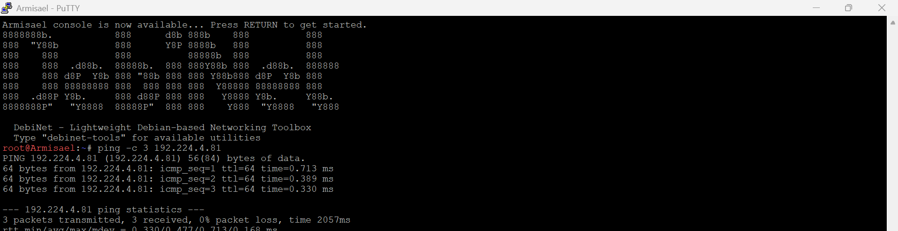
   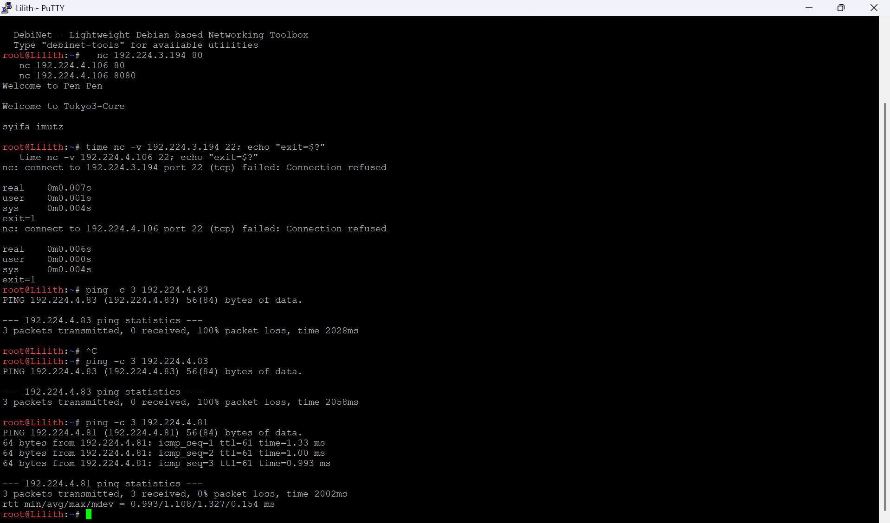
2. **Diagnosa & perbaikan di Shigeru** (menemukan `ip_forward=0`, `blackhole`, `default` ke Mokoto, dan `ip rule pref 90` → `table 100` berisi `unreachable default`):
   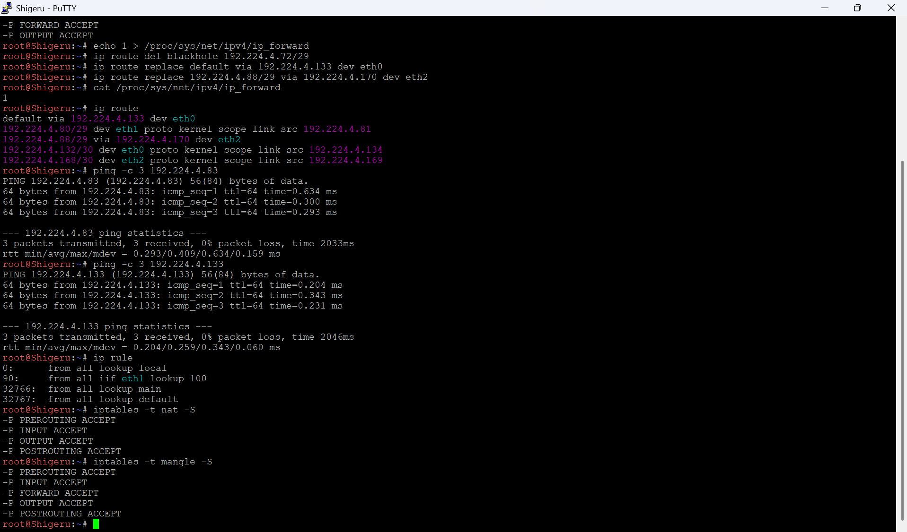
   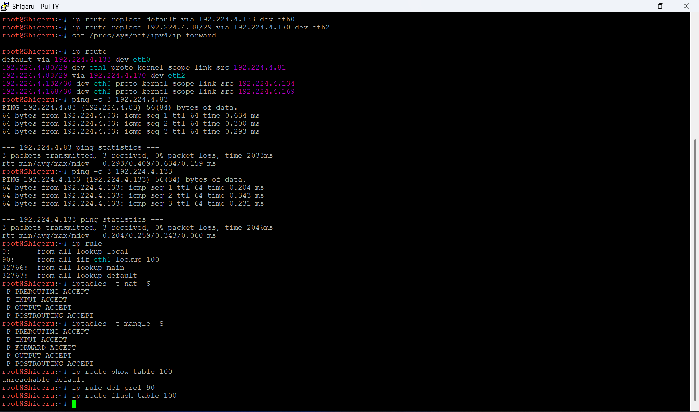
3. **Setelah perbaikan:** Lilith (`192.224.4.74`) kembali berhasil ping Armisael (`192.224.4.83`) dengan `0% packet loss`:
   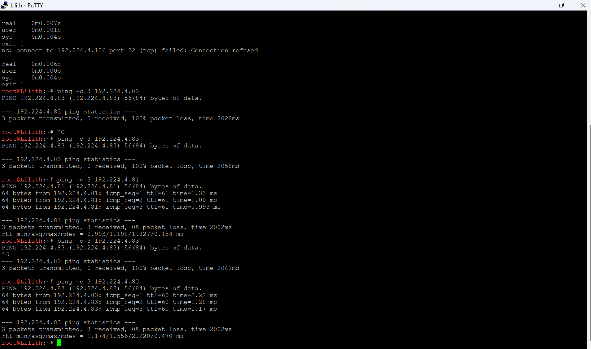

---

## Soal 10: Sabotase NAT (`break_nat.sh` di Misato & Gendou)

> **Soal:**
> 10. Para pilot terkunci di dalam: paginya giliran para pilot mengeluh. Unit-01, Unit-02, dan Unit-00 di Cage tidak bisa ping 8.8.8.8. Padahal Spy di Intel baik-baik saja, dan ping dari Cage ke Lilith normal. Jalankan `break_nat.sh` di Misato dan di Gendo. Filenya sama, dijalankan di masing-masing node. Jelaskan kenapa Cage terdampak tapi Intel tidak. Buktikan Unit-01 bisa ping 8.8.8.8, dan sebutkan di router mana alamat sumber diterjemahkan.

### Penyebab yang Ditemukan (2 Penyebab)

Setelah menjalankan `bash break_nat.sh` di **Misato** dan **Gendou**, ditemukan **2 rule sabotase** di tabel `nat` (`POSTROUTING`):

1. **Di Misato:**
   ```
   -A POSTROUTING -s 192.224.4.64/29 ! -d 192.224.0.0/16 -o eth0 -j SNAT --to-source 172.31.99.1
   ```
   Semua paket dari Switch-Cage (`192.224.4.64/29`) menuju tujuan di luar `192.224.0.0/16` (seperti `8.8.8.8`) yang keluar lewat `eth0` menuju Gendou diubah IP sumbernya menjadi `172.31.99.1`. Ketika sampai di Gendou, paket ini ditolak oleh firewall Soal 5 (`FORWARD` hanya mengizinkan `-s 192.224.0.0/16`) dan tidak terkena `MASQUERADE`.
2. **Di Gendou:**
   ```
   -A POSTROUTING -s 192.224.4.64/29 -o eth0 -j RETURN
   ```
   Dipasang **di atas** rule `MASQUERADE` pada `POSTROUTING`. Akibatnya, paket dari Switch-Cage (`192.224.4.64/29`) yang keluar lewat `eth0` (NAT1) langsung keluar dari chain (`RETURN`) tanpa diterjemahkan IP sumbernya (`MASQUERADE` terlewati).

### Jawaban Analisis

- **Kenapa Cage terdampak tapi Intel tidak?**
  Kedua rule sabotase (baik `SNAT` di Misato maupun `RETURN` di Gendou) hanya mencocokkan sumber **`-s 192.224.4.64/29`** (Switch-Cage). **Spy** berada di Switch-Intel (`192.224.4.100/30`) dan melewati router Kaji, sehingga tidak cocok dengan rule tersebut dan tetap terkena `MASQUERADE` di Gendou.
- **Kenapa ping Cage → Lilith tetap normal?**
  Tujuan Lilith (`192.224.4.74`) masih di dalam `192.224.0.0/16` sehingga tidak memenuhi `! -d 192.224.0.0/16` di Misato, dan di Gendou traffic antar-LAN keluar lewat `eth4` (bukan `eth0`), sehingga tidak melewati kedua rule sabotase.
- **Di router mana alamat sumber diterjemahkan?**
  Alamat sumber jaringan internal hanya diterjemahkan di **Gendou** (pada `eth0` yang terhubung ke **NAT1** lewat `MASQUERADE`). Router **Misato** tidak melakukan translasi NAT.

### Perintah Perbaikan

1. **Di console Misato:**
   ```bash
   iptables -t nat -D POSTROUTING -s 192.224.4.64/29 ! -d 192.224.0.0/16 -o eth0 -j SNAT --to-source 172.31.99.1
   ```
2. **Di console Gendou:**
   ```bash
   iptables -t nat -D POSTROUTING -s 192.224.4.64/29 -o eth0 -j RETURN
   ```

### Hasil Pengujian Soal 10

1. **Spy di Intel** tetap normal (`ping 8.8.8.8` `0% packet loss`):
   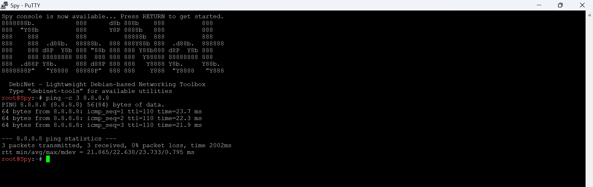
2. **Diagnosa & perbaikan di Misato dan Gendou:**
   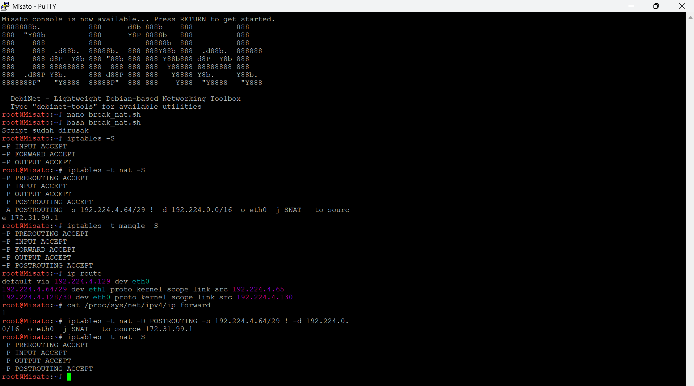
   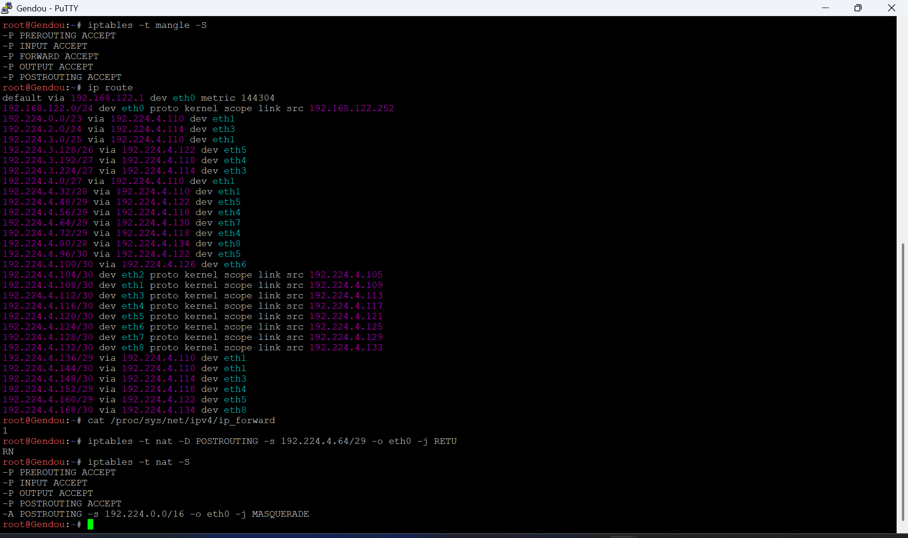
3. **Unit-01 di Cage** (sebelum perbaikan gagal `100% packet loss` ke `8.8.8.8` tapi bisa ke Lilith `192.224.4.74`, setelah perbaikan kembali berhasil `ping 8.8.8.8` `0% packet loss`):
   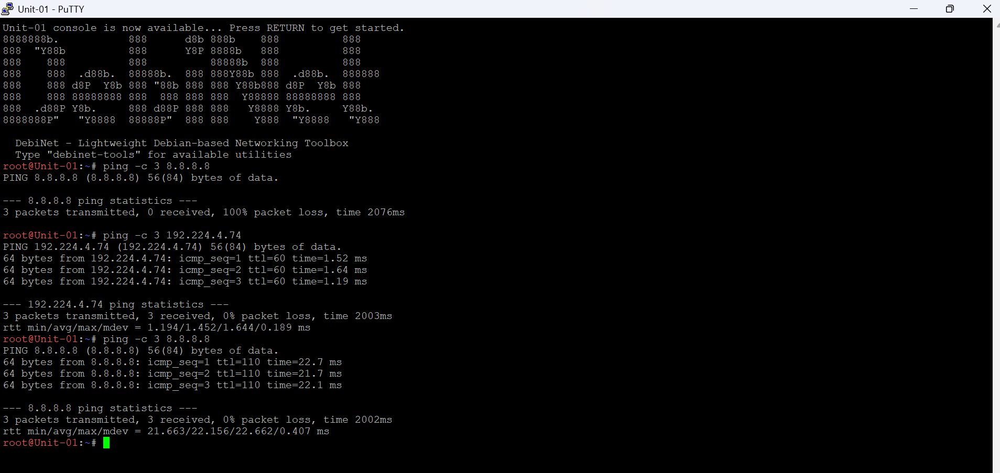


## Soal 11: Casper Harus Jadi Hantu (Magi-Casper)

> **Soal:**
> 11. Casper harus jadi hantu: Casper adalah MAGI paling rahasia. Kalau SEELE tahu ia masih hidup, mereka tahu ke mana harus menyerang. Tidak ada perangkat lain yang boleh mem-ping Casper, termasuk yang satu switch. Casper sendiri tetap boleh mem-ping siapa saja. Layanan TCP 5000 Casper tetap hidup. Buktikan ping ke Casper dari Balthasar dan Lilith gagal, sedangkan ping dari Casper ke keduanya berhasil.

### Penjelasan

- Rule dipasang **di Magi-Casper sendiri** (`192.224.4.58`), bukan di router Fuyutsuki. Balthasar dan Melchior berada satu switch (Switch-Terminal) dengan Casper, sehingga ping mereka langsung lewat switch (layer 2) tanpa melewati router.
- Yang diblok hanya **ICMP echo-request (type 8)** yang masuk melalui chain `INPUT`.
- Balasan **echo-reply (type 0)** untuk ping yang dikirim Casper tidak diblok, sehingga Casper tetap bisa mem-ping perangkat lain.
- Rule hanya mencocokkan ICMP, sehingga layanan **TCP 5000** tidak terganggu.
- `iptables -C ... ||` mencegah rule dobel jika script dijalankan berulang.

### Persiapan

Paket dari Soal 7 dipasang ulang dan listener TCP 5000 dijalankan di background agar console tetap bisa dipakai:
```bash
echo -e "nameserver 8.8.8.8\nnameserver 1.1.1.1" > /etc/resolv.conf
apt-get update; apt-get install -y netcat-traditional iptables
(while true; do nc.traditional -l -p 5000 >> /root/casper.log < /dev/null || sleep 1; done) &
```

### Script `/root/no11.sh` (di Magi-Casper)

```bash
#!/bin/bash
# Soal 11 - tidak ada yang boleh ping Casper
iptables -C INPUT -p icmp --icmp-type echo-request -j DROP 2>/dev/null || \
iptables -A INPUT -p icmp --icmp-type echo-request -j DROP
iptables -S INPUT
```

### Cara Menjalankan

```bash
chmod +x /root/no11.sh
bash /root/no11.sh
```

### Hasil Pengujian Soal 11

1. **Sebelum rule dipasang**, Lilith masih bisa ping Casper (`0% packet loss`):

   


2. **Script dijalankan di Casper**, rule `-A INPUT -p icmp -m icmp --icmp-type 8 -j DROP` terpasang:

   
   
3. **Balthasar** (satu switch dengan Casper) gagal ping Casper (`100% packet loss`):

   

   
4. **Lilith** gagal ping Casper (`100% packet loss`), tetapi layanan TCP 5000 tetap hidup (`nc` ke port 5000 `exit=0`):

   
   
5. **Casper** tetap bisa ping Balthasar (`192.224.4.59`) dan Lilith (`192.224.4.74`) dengan `0% packet loss`. Pesan dari Lilith tercatat di `/root/casper.log`, dan counter rule DROP naik menjadi **6 pkts** (3 dari Lilith + 3 dari Balthasar):

   


## Soal 12: Teknisi yang Kelewat Semangat (`break_fw.sh` di Magi-Casper)

> **Soal:**
> 12. Teknisi yang kelewat semangat: seorang teknisi menjalankan script hardening di Casper lalu pulang tanpa mengecek. Paginya Casper tidak bisa ping 8.8.8.8 dan tidak bisa apt-get update. Unit-00 juga tidak bisa menyambung ke TCP 5000 Casper. Ping ke Casper tetap ditolak, dan itu memang benar. Jalankan `break_fw.sh` di Magi-Casper, lalu perbaiki tanpa membatalkan tujuan hardening. Casper tetap menolak semua lalu lintas masuk yang tidak diizinkan, dan policy INPUT tetap DROP. Buktikan nc dari Unit-00 ke Casper port 5000 berhasil dan apt-get update di Casper berhasil.

### Langkah Diagnosa

1. Simpan kondisi Casper **sebelum** sabotase sebagai pembanding:
```bash
   iptables-save | grep -v "^#" > /root/casper-sebelum.rules
   cp /etc/resolv.conf /root/resolv.sebelum
   ip route > /root/route.sebelum
```
2. Jalankan `bash /root/break_fw.sh` **tanpa membaca isinya**, lalu reproduksi gejala:
   - Casper `ping -c 3 8.8.8.8` gagal (`100% packet loss`).
   - Casper `apt-get update` gagal (`Temporary failure resolving 'deb.debian.org'`).
   - Unit-00 `time nc -w 3 192.224.4.58 5000` menggantung **3,009 detik** lalu `exit=1`.
3. Periksa kondisi akhir firewall dengan `iptables -S` dan counter dengan `iptables -L -v -n --line-numbers`:
```
   -P INPUT DROP
   -P FORWARD ACCEPT
   -P OUTPUT ACCEPT
   -A INPUT -i lo -j ACCEPT
   -A INPUT -p icmp -j DROP
   -A OUTPUT -p udp -m udp --dport 53 -j DROP
```

### Penyebab yang Ditemukan (4 Penyebab)

1. **`INPUT -p icmp -j DROP` memblok semua jenis ICMP**, termasuk echo-reply (type 0). Ping Casper ke 8.8.8.8 terkirim, tetapi balasannya dibuang (counter icmp DROP = 3 pkts).
2. **`OUTPUT -p udp --dport 53 -j DROP`** memblok query DNS keluar, sehingga apt gagal resolve `deb.debian.org` (counter udp dpt:53 DROP = 96 pkts).
3. **Policy INPUT DROP tanpa izin `ESTABLISHED,RELATED`**. Semua balasan koneksi yang dimulai Casper (DNS, HTTP apt, ping) ikut dibuang. Walaupun DNS dibuka, apt tetap akan gagal.
4. **Tidak ada `ACCEPT` untuk TCP 5000**. Koneksi Unit-00 ke port 5000 terkena policy DROP sehingga menggantung sampai timeout (counter policy DROP = 3 packets, 180 bytes, yaitu 3 paket SYN dari Unit-00).

Selain itu, script meng-flush chain `INPUT` sehingga rule Soal 11 terhapus. Ping ke Casper tetap ditolak hanya karena tertutup rule `-p icmp -j DROP` yang terlalu luas.

### Script Perbaikan `/root/no12.sh` (di Magi-Casper)

```bash
#!/bin/bash
# Soal 12 - perbaiki hardening Casper tanpa membatalkan tujuannya
# Aman dijalankan berulang (chain di-flush dulu, rule tidak dobel)

# 1. buka sementara agar tidak terkunci selama dibersihkan
iptables -P INPUT ACCEPT
iptables -P OUTPUT ACCEPT
iptables -F INPUT
iptables -F OUTPUT

# 2. yang boleh masuk
iptables -A INPUT -i lo -j ACCEPT
iptables -A INPUT -m conntrack --ctstate ESTABLISHED,RELATED -j ACCEPT
iptables -A INPUT -m conntrack --ctstate INVALID -j DROP
iptables -A INPUT -p icmp --icmp-type echo-request -j DROP
iptables -A INPUT -p tcp --dport 5000 -j ACCEPT

# 3. hardening tetap: sisanya ditolak
iptables -P INPUT DROP

iptables -S
```

### Penjelasan Perbaikan

- **Rule DNS di `OUTPUT` dihapus** (`-F OUTPUT`), sehingga Casper bisa mengirim query DNS lagi.
- **`ESTABLISHED,RELATED` diizinkan**, sehingga balasan dari koneksi yang dimulai Casper (DNS, HTTP apt, echo-reply ping) bisa masuk kembali.
- **ICMP DROP dipersempit menjadi echo-request (type 8) saja**, sehingga ping ke Casper tetap ditolak (tujuan Soal 11), tetapi balasan ping milik Casper tidak ikut terblok.
- **TCP 5000 diizinkan**, sehingga layanan Casper bisa diakses Unit-00.
- **Policy `INPUT` tetap `DROP`**, sehingga lalu lintas masuk lain yang tidak diizinkan tetap ditolak. Tujuan hardening tidak batal.

### Hasil Pengujian Soal 12

1. **Gejala setelah `break_fw.sh`**: Casper gagal ping 8.8.8.8 dan gagal `apt-get update`:

   

2. **Gejala di Unit-00**: koneksi ke port 5000 menggantung 3,009 detik lalu `exit=1`:

   

3. **Diagnosa** dari `iptables -S` dan counter `iptables -L -v -n`:

   

4. **Perbaikan** dengan `no12.sh`, policy `INPUT` tetap `DROP`:

   

5. **Unit-00** berhasil mengirim pesan ke Casper port 5000 (`exit=0`):
   
   

6. **Casper** menerima pesan di `/root/casper.log`, `apt-get update` berhasil, `ping 8.8.8.8` berhasil (`0% packet loss`), dan counter menunjukkan ESTABLISHED 27 pkts,
   icmp type 8 DROP 3 pkts, dpt:5000 ACCEPT 3 pkts:
   
   

7. **Lilith** tetap gagal ping Casper (`100% packet loss`), sesuai tujuan hardening:
   


## Soal 13: Brankas Balthasar (Magi-Balthasar)

> **Soal:**
> 13. Brankas Balthasar: Balthasar menyimpan seluruh data Geofront, tapi terlalu banyak yang bisa mengetuk pintunya, termasuk tetangga satu switch. Hanya Casper dan semua Pilot yang boleh menyambung ke TCP 5000 dan 5001. Node lain, termasuk yang satu switch, harus langsung ditolak di kedua port itu, bukan dibiarkan menggantung sampai timeout. Lalu lintas lain tidak boleh terganggu. Balthasar tetap harus bisa ping 8.8.8.8 dan menerima balasannya. Buktikan nc ke port 5000 dan 5001: Unit-01 berhasil, Lilith dan Melchior ditolak seketika.

### Penjelasan

- Rule dipasang **di Magi-Balthasar sendiri** (`192.224.4.59`), karena Melchior dan Casper berada satu switch (Switch-Terminal) sehingga koneksinya tidak melewati router Fuyutsuki.
- Dibuat chain khusus **`BRANKAS`** yang hanya dipanggil untuk **TCP port 5000 dan 5001** (`-m multiport`). Lalu lintas lain (ping, DNS, apt) tidak masuk ke chain ini dan policy `INPUT` tetap `ACCEPT`, sehingga tidak terganggu.
- Sumber yang diizinkan:
  1. **Magi-Casper**: `192.224.4.58`
  2. **Pilot di Switch-Cage** (Unit-01, Unit-02, Unit-00): `192.224.4.66–192.224.4.68`
  3. **Pilot Sachiel** (grup 55 host di Switch-Bunker): `192.224.3.128/26`
- Selain itu ditolak dengan **`REJECT --reject-with tcp-reset`**. Balthasar langsung membalas TCP RST, sehingga klien langsung mendapat "Connection refused". Jika memakai `DROP`, klien akan menggantung sampai timeout.
- Chain di-flush setiap script dijalankan, dan jump dari `INPUT` dihapus lalu dipasang ulang, sehingga rule tidak dobel.

### Persiapan

Paket `netcat-traditional` dipasang ulang dan listener port 5000/5001 dinyalakan di background:
```bash
echo -e "nameserver 8.8.8.8\nnameserver 1.1.1.1" > /etc/resolv.conf
apt-get update; apt-get install -y netcat-traditional
(while true; do nc.traditional -l -p 5000 >> /root/balthasar_5000.log < /dev/null || sleep 1; done) &
(while true; do nc.traditional -l -p 5001 >> /root/balthasar_5001.log < /dev/null || sleep 1; done) &
```

### Script `/root/no13.sh` (di Magi-Balthasar)

```bash
#!/bin/bash
# Soal 13 - hanya Casper & Pilot yang boleh ke TCP 5000/5001 Balthasar
CASPER=192.224.4.58
PILOT_CAGE=192.224.4.66-192.224.4.68     # Unit-01, Unit-02, Unit-00
SACHIEL=192.224.3.128/26                 # Sachiel (grup 55 host di Switch-Bunker)

# chain khusus, dikosongkan setiap script dijalankan (tidak dobel)
iptables -N BRANKAS 2>/dev/null || iptables -F BRANKAS
iptables -D INPUT -p tcp -m multiport --dports 5000,5001 -j BRANKAS 2>/dev/null
iptables -I INPUT 1 -p tcp -m multiport --dports 5000,5001 -j BRANKAS

iptables -A BRANKAS -s $CASPER -j ACCEPT
iptables -A BRANKAS -m iprange --src-range $PILOT_CAGE -j ACCEPT
iptables -A BRANKAS -s $SACHIEL -j ACCEPT
iptables -A BRANKAS -p tcp -j REJECT --reject-with tcp-reset

iptables -S
```

### Cara Menjalankan

```bash
chmod +x /root/no13.sh
bash /root/no13.sh
```

### Hasil Pengujian Soal 13

1. **Script dijalankan di Balthasar**, chain `BRANKAS` terpasang:

   

2. **Unit-01** (Pilot) berhasil menyambung ke port 5000 dan 5001 (`exit=0`):

   

3. **Lilith** ditolak seketika di kedua port (`real 0m0.006s`, `exit=1`):
   
   

4. **Melchior** (satu switch dengan Balthasar) juga ditolak seketika (`real 0m0.005s`–`0m0.006s`, `exit=1`):
   
   

5. **Balthasar** menerima pesan Unit-01 di log, tetap bisa `ping 8.8.8.8` (`0% packet loss`), dan counter `BRANKAS` menunjukkan ACCEPT Pilot = 10 pkts dan REJECT
   **4pkts** (2 dari Lilith + 2 dari Melchior):
   
   

## Soal 14: Jam Kunjungan Sang Pinguin (Pen-Pen)

> **Soal:**
> 14. Jam kunjungan sang pinguin: Pen-Pen, pinguin Misato, menyimpan sesuatu yang bikin banyak orang penasaran. Ia hanya boleh dihubungi sesuai jadwal di bawah. Jadwal berlaku untuk ping dan TCP 80 ke Pen-Pen, dari mana pun asalnya. Jam komputer tidak boleh diubah.
> - Pilot: 08.00 sampai 16.00 WIB, hanya Senin sampai Jumat
> - Staf Geofront: 17.00 sampai 23.00 WIB, setiap hari
> - Terduga Dummy System: tidak pernah, selalu ditolak
> - Lainnya: bebas, tanpa batasan
>
> Simpan jadwal sebagai variabel di awal script Pen-Pen, bernama PILOT_START, PILOT_STOP, PILOT_DAYS, STAF_START, dan STAF_STOP. Untuk uji, ubah variabel itu sampai jadwalnya cocok dengan jam sekarang, lalu sampai tidak cocok. Ingat, iptables membaca jam UTC, 7 jam lebih lambat dari WIB. Tunjukkan hasil ping dari Unit-01, Lilith, dan Spy pada kedua kondisi.

### Penjelasan

- Rule dipasang **di Pen-Pen** (`192.224.3.194`) karena jadwal berlaku dari mana pun asalnya.
- Anggota tiap kelompok:
  1. **Pilot**: Unit-01, Unit-02, Unit-00 (`192.224.4.66–68`) dan Sachiel (`192.224.3.128/26`)
  2. **Staf Geofront**: Lilith dan Adam (`192.224.4.74–75`)
  3. **Terduga Dummy System**: Entry-Plug, Dummy-Plug (`192.224.4.50–51`) dan Spy (`192.224.4.102`)
- Dibuat chain **`JADWAL_PENPEN`** yang hanya dipanggil untuk **ICMP echo-request** dan **TCP port 80**. Lalu lintas lain tidak terpengaruh.
- Urutan rule dalam chain:
  1. Terduga Dummy: selalu `DROP`
  2. Pilot: `ACCEPT` jika sesuai jam dan hari pilot, selain itu `DROP`
  3. Staf: `ACCEPT` jika sesuai jam staf, selain itu `DROP`
  4. Lainnya: `ACCEPT`
- Jadwal disimpan sebagai variabel **WIB** di awal script. Modul `-m time` pada iptables membaca jam **UTC**, sehingga fungsi `wib2utc` mengurangi 7 jam secara otomatis: Pilot 08:00–16:00 WIB menjadi **01:00–09:00 UTC**, dan Staf 17:00–23:00 WIB menjadi **10:00–16:00 UTC**. Jam sistem tidak diubah.

### Script `/root/no14.sh` (di Pen-Pen)

```bash
#!/bin/bash
# ===== JADWAL (WIB) - ubah di sini untuk uji =====
PILOT_START="08:00"
PILOT_STOP="16:00"
PILOT_DAYS="Mon,Tue,Wed,Thu,Fri"
STAF_START="17:00"
STAF_STOP="23:00"
# ================================================

PILOT_CAGE=192.224.4.66-192.224.4.68    # Unit-01, Unit-02, Unit-00
SACHIEL=192.224.3.128/26                # Sachiel
STAF=192.224.4.74-192.224.4.75          # Lilith, Adam
DUMMY_LAB=192.224.4.50-192.224.4.51     # Entry-Plug, Dummy-Plug
SPY=192.224.4.102                       # Spy

# iptables memakai UTC -> WIB dikurangi 7 jam
wib2utc() {
  h=${1%%:*}; m=${1#*:}
  h=${h#0}; [ -z "$h" ] && h=0
  printf '%02d:%s' $(( (h + 17) % 24 )) "$m"
}
P_START=$(wib2utc $PILOT_START); P_STOP=$(wib2utc $PILOT_STOP)
S_START=$(wib2utc $STAF_START);  S_STOP=$(wib2utc $STAF_STOP)
echo "Jam node sekarang: $(TZ=WIB-7 date '+%a %H:%M WIB') = $(date -u '+%H:%M UTC')"
echo "Pilot WIB $PILOT_START-$PILOT_STOP = UTC $P_START-$P_STOP ($PILOT_DAYS)"
echo "Staf  WIB $STAF_START-$STAF_STOP = UTC $S_START-$S_STOP (setiap hari)"

# chain jadwal, dikosongkan setiap script dijalankan (tidak dobel)
iptables -N JADWAL_PENPEN 2>/dev/null || iptables -F JADWAL_PENPEN
iptables -D INPUT -p icmp --icmp-type echo-request -j JADWAL_PENPEN 2>/dev/null
iptables -D INPUT -p tcp --dport 80 -j JADWAL_PENPEN 2>/dev/null
iptables -I INPUT 1 -p icmp --icmp-type echo-request -j JADWAL_PENPEN
iptables -I INPUT 1 -p tcp --dport 80 -j JADWAL_PENPEN

# 1. Terduga Dummy System: selalu ditolak
iptables -A JADWAL_PENPEN -m iprange --src-range $DUMMY_LAB -j DROP
iptables -A JADWAL_PENPEN -s $SPY -j DROP
# 2. Pilot: hanya di jam & hari pilot
iptables -A JADWAL_PENPEN -m iprange --src-range $PILOT_CAGE \
  -m time --timestart $P_START --timestop $P_STOP --weekdays $PILOT_DAYS -j ACCEPT
iptables -A JADWAL_PENPEN -s $SACHIEL \
  -m time --timestart $P_START --timestop $P_STOP --weekdays $PILOT_DAYS -j ACCEPT
iptables -A JADWAL_PENPEN -m iprange --src-range $PILOT_CAGE -j DROP
iptables -A JADWAL_PENPEN -s $SACHIEL -j DROP
# 3. Staf Geofront: setiap hari di jam staf
iptables -A JADWAL_PENPEN -m iprange --src-range $STAF \
  -m time --timestart $S_START --timestop $S_STOP -j ACCEPT
iptables -A JADWAL_PENPEN -m iprange --src-range $STAF -j DROP
# 4. Lainnya: bebas
iptables -A JADWAL_PENPEN -j ACCEPT

iptables -L JADWAL_PENPEN -n --line-numbers
```

### Cara Uji

Jam node mengikuti jam server GNS3. Saat pengujian, `TZ=WIB-7 date` menunjukkan **Selasa 16:47 WIB = 09:47 UTC**. Variabel jadwal diubah dengan `sed`, lalu script dijalankan ulang:

1. **Kondisi A (jadwal cocok)**: PILOT dan STAF diubah menjadi 16:00–18:00 WIB (09:00–11:00 UTC), mencakup jam node.
```bash
   sed -i 's/^PILOT_START=.*/PILOT_START="16:00"/' /root/no14.sh
   sed -i 's/^PILOT_STOP=.*/PILOT_STOP="18:00"/'   /root/no14.sh
   sed -i 's/^STAF_START=.*/STAF_START="16:00"/'   /root/no14.sh
   sed -i 's/^STAF_STOP=.*/STAF_STOP="18:00"/'     /root/no14.sh
   bash /root/no14.sh
```
2. **Kondisi B (jadwal tidak cocok)**: PILOT diubah menjadi 08:00–09:00 WIB (01:00–02:00 UTC), STAF menjadi 20:00–21:00 WIB (13:00–14:00 UTC).
```bash
   sed -i 's/^PILOT_START=.*/PILOT_START="08:00"/' /root/no14.sh
   sed -i 's/^PILOT_STOP=.*/PILOT_STOP="09:00"/'   /root/no14.sh
   sed -i 's/^STAF_START=.*/STAF_START="20:00"/'   /root/no14.sh
   sed -i 's/^STAF_STOP=.*/STAF_STOP="21:00"/'     /root/no14.sh
   bash /root/no14.sh
```
3. Setelah pengujian, variabel **dikembalikan ke jadwal asli** (08:00–16:00 dan 17:00–23:00) lalu script dijalankan ulang.

### Hasil Pengujian Soal 14

**Kondisi A: jadwal cocok dengan jam node**

1. **Script kondisi A**: jadwal Pilot dan Staf diubah menjadi 16:00–18:00 WIB (09:00–11:00 UTC). Jam node saat itu Selasa 16:47 WIB = 09:47 UTC, sehingga masuk ke jendela jadwal:
   

2. **Unit-01 (Pilot)** berhasil ping Pen-Pen (`0% packet loss`), karena jam dan hari sesuai jadwal Pilot:
   

3. **Lilith (Staf Geofront)** berhasil ping Pen-Pen (`0% packet loss`), karena jam sesuai jadwal Staf:
   

4. **Spy (Terduga Dummy System)** gagal ping Pen-Pen (`100% packet loss`), karena Dummy System selalu ditolak:
   


**Kondisi B: jadwal tidak cocok dengan jam node**

5. **Script kondisi B**: jadwal Pilot diubah menjadi 08:00–09:00 WIB (01:00–02:00 UTC) dan Staf menjadi 20:00–21:00 WIB (13:00–14:00 UTC). Jam node saat itu Selasa 16:49 WIB = 09:49 UTC, sehingga berada di luar kedua jendela jadwal:
  

6. **Unit-01 (Pilot)** gagal ping Pen-Pen (`100% packet loss`), karena di luar jam Pilot:
   

7. **Lilith (Staf Geofront)** gagal ping Pen-Pen (`100% packet loss`), karena di luar jam Staf:
   

8. **Spy (Terduga Dummy System)** tetap gagal ping Pen-Pen (`100% packet loss`):
   


**Ringkasan:** pada kondisi A, Unit-01 dan Lilith berhasil sedangkan Spy gagal. Pada kondisi B, ketiganya gagal. Setelah pengujian, variabel jadwal dikembalikan ke nilai asli (Pilot 08:00–16:00 WIB, Staf 17:00–23:00 WIB).


 ## Soal 15: Banjir Ping di Pusat Komando (Tokyo3-Core)

> **Soal:**
> 15. Banjir ping di pusat komando: Instrumentality makin dekat, dan semua orang berebut mem-ping Tokyo3-Core. Banjir ping bisa melumpuhkannya. Batasi Tokyo3-Core agar hanya menjawab maksimal 5 ping per detik, dan buang kelebihannya. Aturan ini tidak boleh mengganggu ping di bawah batas. Aturan ini juga tidak boleh membatasi ping yang dikirim Tokyo3-Core sendiri. Pastikan rule benar-benar mengenai paket yang dituju. Periksa urutan rule dan jenis paketnya. Buktikan ping rapat dari Lilith, misalnya `ping -i 0.1 -c50`, sebagian hilang, dan tunjukkan counter rule pembuangan naik. Buktikan ping biasa semuanya berhasil, dengan jeda minimal 3 detik di antaranya.

### Penjelasan

- **Jenis paket**: yang dibatasi hanya `-p icmp --icmp-type echo-request` (type 8). Jika hanya memakai `-p icmp`, balasan **echo-reply** untuk ping milik Tokyo3-Core ikut dibatasi.
- **Chain**: rule dipasang di **`INPUT`**. Jika dipasang di `OUTPUT`, ping keluar milik Tokyo3-Core yang terbatasi.
- **Urutan**: jump ke chain dipasang paling atas (`-I INPUT 1`). Jika ada rule `ACCEPT` umum di atasnya, rule limit tidak pernah terkena.
- **Pembatas**: dibuat chain **`BATAS_PING`**. Rule pertama `-m limit --limit 5/second --limit-burst 5 -j ACCEPT` menerima paket selama masih dalam batas, rule kedua `-j DROP` membuang kelebihannya.
- Chain di-flush setiap script dijalankan, sehingga rule tidak dobel.

### Persiapan

Listener Soal 8 di Tokyo3-Core dijalankan di background agar console tidak terkunci:
```bash
nohup bash /root/no8.sh > /root/no8.log 2>&1 &
```

### Script `/root/no15.sh` (di Tokyo3-Core)

```bash
#!/bin/bash
# Soal 15 - Tokyo3-Core menjawab maksimal 5 ping per detik
# Hanya echo-request MASUK (INPUT) yang dibatasi:
#  - echo-reply untuk ping milik Tokyo3-Core tidak kena
#  - ping keluar (OUTPUT) tidak kena

iptables -N BATAS_PING 2>/dev/null || iptables -F BATAS_PING
iptables -D INPUT -p icmp --icmp-type echo-request -j BATAS_PING 2>/dev/null
iptables -I INPUT 1 -p icmp --icmp-type echo-request -j BATAS_PING

iptables -A BATAS_PING -m limit --limit 5/second --limit-burst 5 -j ACCEPT
iptables -A BATAS_PING -j DROP

iptables -S
```

### Cara Menjalankan

```bash
chmod +x /root/no15.sh
bash /root/no15.sh
```

### Hasil Pengujian Soal 15

1. **Script dijalankan di Tokyo3-Core**, chain `BATAS_PING` terpasang di posisi paling atas `INPUT`:
   

2. **Ping rapat dari Lilith** (`ping -i 0.1 -c 50 192.224.4.106`): 50 paket dikirim, 30 diterima, **40% packet loss**:
   

3. **Counter `BATAS_PING`** di Tokyo3-Core naik: ACCEPT = 30 pkts, **DROP = 20 pkts**:
   

4. **Ping biasa dari Lilith** dengan jeda 3 detik (`sleep 3; ping -c 5 192.224.4.106`, dua kali) semuanya berhasil (`0% packet loss`):
   

5. **Ping milik Tokyo3-Core sendiri** (`ping -i 0.1 -c 30 192.224.4.105`) tidak dibatasi (`0% packet loss`), dan counter `BATAS_PING` tetap 0:
   


### Analisis

- Ping rapat mengirim 10 paket per detik selama 5 detik (50 paket). Yang diizinkan adalah 5 paket cadangan awal + 5 paket/detik × 5 detik ≈ **30 paket**, sehingga **20 paket** dibuang.
- Ping biasa (1 paket per detik) berada di bawah batas, sehingga tidak terganggu.
- Ping yang dikirim Tokyo3-Core tidak terkena rule, karena balasan yang diterimanya berupa echo-reply (type 0), bukan echo-request.

## Soal 16: Pencuri yang Mencoba Setiap Pintu (Tokyo3-Core)

> **Soal:**
> 16. Pencuri yang mencoba setiap pintu: dari Switch-Lab, Dummy-Plug mengetuk port sensitif Tokyo3-Core satu per satu seperti pencuri. Ritsuko ingin tahu setiap percobaannya, dan pintunya harus dibanting. Setiap koneksi TCP dari Dummy-Plug ke port 22, 23, dan 3306 di Tokyo3-Core harus dicatat di log dengan prefix huruf besar `SCAN-NERV:`, lalu ditolak seketika. Port 80 dan 8080 tetap bisa diakses, dan klien lain tidak boleh terganggu. Buktikan `nc -w` dari Dummy-Plug ke port 22, 23, dan 3306 langsung ditolak, dan ke port 80 dan 8080 berhasil. Tunjukkan counter rule pencatatan, karena log kernel sering tidak terlihat di container.

### Penjelasan

- Rule dipasang di **Tokyo3-Core** (`192.224.4.106`) pada chain `INPUT`. Jump ke chain khusus **`SCAN_NERV`** hanya untuk paket dengan sumber **Dummy-Plug (`192.224.4.51`)**, protokol TCP, dan port tujuan **22, 23, 3306** (`-m multiport`).
- Di dalam chain `SCAN_NERV`:
  1. **`LOG`** paket SYN (`--syn`), sehingga setiap percobaan koneksi baru tercatat satu kali dengan prefix `SCAN-NERV: `.
  2. **`REJECT --reject-with tcp-reset`**: koneksi langsung "dibanting" dengan TCP RST, sehingga klien langsung gagal tanpa menunggu timeout.
- `LOG` harus berada **sebelum** `REJECT`. Jika dibalik, paket sudah ditolak sebelum sempat dicatat.
- Klien lain dan port 80/8080 tidak cocok dengan rule, sehingga tidak terpengaruh.
- Log kernel sering tidak terlihat dari dalam container (`dmesg` tidak bisa diakses), sehingga **counter rule `LOG`** dipakai sebagai bukti pencatatan.

### Script `/root/no16.sh` (di Tokyo3-Core)

```bash
#!/bin/bash
# Soal 16 - catat & tolak scan Dummy-Plug ke port sensitif Tokyo3-Core
DUMMY=192.224.4.51

# chain khusus, dikosongkan setiap script dijalankan (tidak dobel)
iptables -N SCAN_NERV 2>/dev/null || iptables -F SCAN_NERV
iptables -D INPUT -s $DUMMY -p tcp -m multiport --dports 22,23,3306 -j SCAN_NERV 2>/dev/null
iptables -I INPUT 1 -s $DUMMY -p tcp -m multiport --dports 22,23,3306 -j SCAN_NERV

# 1. catat setiap koneksi baru (paket SYN) dengan prefix huruf besar
iptables -A SCAN_NERV -p tcp --syn -j LOG --log-prefix "SCAN-NERV: " --log-level 4
# 2. banting pintunya: tolak seketika dengan TCP reset
iptables -A SCAN_NERV -p tcp -j REJECT --reject-with tcp-reset

iptables -S
```

### Cara Menjalankan

```bash
chmod +x /root/no16.sh
bash /root/no16.sh
```

### Hasil Pengujian Soal 16

1. **Script dijalankan di Tokyo3-Core**, rule `LOG` dengan prefix `SCAN-NERV:` dan rule `REJECT` terpasang (rule Soal 15 tetap ada):
   
2. **Dummy-Plug** ke port 22, 23, dan 3306 langsung ditolak (`real 0m0.003s`–`0m0.007s`, `exit=1`):
   
3. **Dummy-Plug** ke port 80 mendapat `Welcome to Tokyo3-Core`, dan ke port 8080 mendapat `syifa imutz` (`exit=0`):
   
4. **Counter `SCAN_NERV`** di Tokyo3-Core: LOG = **3 pkts** dan REJECT = **3 pkts** (180 bytes). Log kernel tidak terlihat di container, sehingga counter dipakai sebagai bukti:
   
5. **Lilith** (klien lain) tetap bisa ke port 80. Percobaan ke port 22 gagal karena memang tidak ada layanan:
   
6. **Counter `SCAN_NERV` tetap 3** setelah percobaan Lilith, membuktikan klien lain tidak terkena rule:
   

## Soal 17: Sihir Hitam di Jalur Paket (Fuyutsuki)

> **Soal:**
> 17. Sihir hitam di jalur paket: Ritsuko meninggalkan memo di meja Gendo. Paket dari Casper ke Zeruel tidak pernah sampai ke Zeruel, karena ada router yang diam-diam mengalihkannya ke tempat lain. "Cari saja router yang menjadi gateway Switch-Terminal." Gendo menyuruhmu meniru router yang diam-diam itu untuk menjebak siapa pun. Di Fuyutsuki, alihkan setiap koneksi TCP dari Magi-Casper ke Zeruel supaya sampai di Pen-Pen. Casper tidak boleh sadar. Balasan yang ia terima harus tetap terlihat datang dari Zeruel. Ping tidak dialihkan. Nyalakan listener port 9000 di Pen-Pen dan Zeruel. Dari Casper, kirim pesan ke IP Zeruel port 9000. Buktikan pesan itu muncul di Pen-Pen, bukan di Zeruel. Tunjukkan juga tabel conntrack di Fuyutsuki.

### Penjelasan

- Router yang menjadi gateway Switch-Terminal adalah **Fuyutsuki**, sehingga semua paket Casper (`192.224.4.58`) menuju luar subnet pasti melewati Fuyutsuki.
- Dipakai **DNAT pada chain `PREROUTING`** (tabel `nat`): alamat tujuan paket TCP dari Casper ke Zeruel (`192.224.4.82`) diganti menjadi Pen-Pen (`192.224.3.194`) **sebelum** keputusan routing, sehingga paket diteruskan ke arah Maya → Pen-Pen.
- Pen-Pen juga berada di bawah Fuyutsuki (lewat Maya), sehingga balasan Pen-Pen pasti kembali lewat Fuyutsuki. **Conntrack** di Fuyutsuki otomatis mengembalikan alamat sumber balasan dari `192.224.3.194` menjadi `192.224.4.82`. Akibatnya Casper melihat balasan datang dari Zeruel dan tidak sadar dialihkan.
- Rule hanya untuk `-p tcp`, sehingga **ping (ICMP) tidak dialihkan** dan tetap dijawab Zeruel.
- `iptables -C ... ||` mencegah rule dobel saat script dijalankan ulang.

### Persiapan

1. **Di Fuyutsuki**, pasang `conntrack` untuk melihat tabel koneksi:
```bash
   echo -e "nameserver 8.8.8.8\nnameserver 1.1.1.1" > /etc/resolv.conf
   apt-get update; apt-get install -y conntrack
```
2. **Di Pen-Pen dan Zeruel**, pasang netcat untuk listener port 9000:
```bash
   apt-get update; apt-get install -y netcat-traditional
```

### Script `/root/no17.sh` (di Fuyutsuki)

```bash
#!/bin/bash
# Soal 17 - alihkan diam-diam TCP Casper->Zeruel ke Pen-Pen (DNAT)
CASPER=192.224.4.58
ZERUEL=192.224.4.82
PENPEN=192.224.3.194

# hanya TCP (ping tidak dialihkan); -C mencegah rule dobel
iptables -t nat -C PREROUTING -s $CASPER -d $ZERUEL -p tcp -j DNAT --to-destination $PENPEN 2>/dev/null || \
iptables -t nat -A PREROUTING -s $CASPER -d $ZERUEL -p tcp -j DNAT --to-destination $PENPEN

iptables -t nat -S PREROUTING
```

### Cara Uji

1. Nyalakan listener di **Pen-Pen** (`nc.traditional -n -l -p 9000`) dan **Zeruel** (`nc -n -l -p 9000`).
2. Dari **Casper**, buka koneksi ke IP Zeruel lalu ketik pesan (koneksi dibiarkan terbuka):
```bash
   nc -n -v 192.224.4.82 9000
```
3. Selagi koneksi masih terbuka, periksa tabel conntrack di **Fuyutsuki**:
```bash
   conntrack -L -p tcp --dport 9000
   iptables -t nat -L PREROUTING -v -n
```

### Hasil Pengujian Soal 17

1. **Sebelum rule dipasang**, pesan Casper ke `192.224.4.82:9000` masih diterima di **Zeruel**:
   
2. **Script dijalankan di Fuyutsuki**, rule `DNAT --to-destination 192.224.3.194` terpasang:
   
3. **Casper** menampilkan `Connection to 192.224.4.82 9000 port [tcp/*] succeeded!`, sehingga Casper mengira tersambung ke Zeruel:
   
4. **Pen-Pen** menerima pesan `Halo Zeruel, ini Casper soal 17`:
   
5. **Zeruel** tidak menerima apa pun (layar listener tetap kosong):
   
6. **Tabel conntrack di Fuyutsuki**: `ESTABLISHED src=192.224.4.58 dst=192.224.4.82 sport=40872 dport=9000 src=192.224.3.194 dst=192.224.4.58 sport=9000 dport=40872 [ASSURED]`, dengan counter DNAT 4 pkts:
   
7. **Ping tidak dialihkan**: Casper `ping -c 3 192.224.4.82` berhasil (`0% packet loss`) dan dijawab Zeruel sendiri:
   

### Membaca Tabel Conntrack

- Bagian pertama (`src=192.224.4.58 dst=192.224.4.82`) adalah koneksi asli dari sudut pandang Casper, yaitu menuju Zeruel.
- Bagian kedua (`src=192.224.3.194 dst=192.224.4.58`) adalah arah balasan, yang ternyata datang dari **Pen-Pen**.
- Inilah bukti bahwa Fuyutsuki diam-diam mengalihkan tujuan koneksi, sementara Casper tetap melihat balasan dari Zeruel.

## Soal 18: Gerbang Monolith dan Radar (Shigeru)

> **Soal:**
> 18. Gerbang Monolith dan Radar: Monolith dan Radar menyimpan rahasia terbesar NERV, dan Shigeru menjaganya tanpa kompromi. Pasang aturan di Shigeru. Node di dalam zona boleh memulai koneksi ke mana saja, dan balasannya tetap sampai. Node di luar zona tidak boleh memulai koneksi ke dalam zona. Satu pengecualian: ping dari subnet Terminal boleh masuk. Tolak berdasarkan arah datangnya, yaitu semua yang datang dari sisi Shigeru yang menghadap Gendo. Jangan menulis subnet luar satu per satu, supaya subnet baru langsung ikut terblokir. Buktikan ping Casper ke Zeruel berhasil, sedangkan ping Lilith ke Zeruel gagal.

### Penjelasan

- Zona sensitif terdiri dari **Switch-Monolith** (`192.224.4.80/29`: Zeruel, Armisael) dan **Switch-Radar** (`192.224.4.88/29`: Radar-Array, lewat Mokoto).
- Semua lalu lintas dari luar zona pasti masuk ke Shigeru melalui **`eth0`** (link ke Gendou, `192.224.4.134`). Karena itu filter dipasang pada chain **`FORWARD`** dengan kondisi `-i eth0`, tanpa menulis subnet luar satu per satu. Subnet baru di luar zona otomatis ikut terblokir.
- Rule di chain **`ZONA_SENSITIF`**:
  1. `ESTABLISHED,RELATED` → `ACCEPT`: balasan untuk koneksi yang dimulai dari dalam zona tetap bisa masuk.
  2. ICMP echo-request dari **subnet Terminal (`192.224.4.56/29`)** → `ACCEPT`: pengecualian ping dari Terminal.
  3. Sisanya → `DROP`: koneksi baru dari luar zona ditolak.
- Lalu lintas antar-node di dalam zona (Monolith ↔ Radar lewat `eth2`) dan dari zona ke luar tidak melewati `-i eth0`, sehingga tidak terpengaruh.

### Script `/root/no18.sh` (di Shigeru)

```bash
#!/bin/bash
# Soal 18 - gerbang zona sensitif Monolith & Radar di Shigeru
UPLINK=eth0                    # sisi Shigeru yang menghadap Gendou (192.224.4.133)
TERMINAL_NET=192.224.4.56/29   # subnet Terminal (Casper, Balthasar, Melchior)

# chain khusus, dikosongkan setiap script dijalankan (tidak dobel)
iptables -N ZONA_SENSITIF 2>/dev/null || iptables -F ZONA_SENSITIF
iptables -D FORWARD -i $UPLINK -j ZONA_SENSITIF 2>/dev/null
iptables -A FORWARD -i $UPLINK -j ZONA_SENSITIF

# 1. balasan untuk koneksi yang dimulai dari dalam zona
iptables -A ZONA_SENSITIF -m conntrack --ctstate ESTABLISHED,RELATED -j ACCEPT
# 2. pengecualian: ping dari subnet Terminal
iptables -A ZONA_SENSITIF -s $TERMINAL_NET -p icmp --icmp-type echo-request -j ACCEPT
# 3. selain itu, semua yang datang dari sisi Gendou ditolak
iptables -A ZONA_SENSITIF -j DROP

iptables -S
```

### Cara Menjalankan

```bash
chmod +x /root/no18.sh
bash /root/no18.sh
```

### Hasil Pengujian Soal 18

1. **Script dijalankan di Shigeru**, chain `ZONA_SENSITIF` terpasang pada `FORWARD -i eth0`:
   
2. **Casper** (subnet Terminal) berhasil ping Zeruel (`0% packet loss`):
   
3. **Lilith** (luar zona) gagal ping Zeruel `192.224.4.82` dan Radar-Array `192.224.4.90` (`100% packet loss`):
   
4. **Zeruel** (dalam zona) tetap bisa ping `8.8.8.8` dan Lilith `192.224.4.74` (`0% packet loss`), karena balasannya diizinkan oleh rule `ESTABLISHED`:
   
5. **Counter `ZONA_SENSITIF`**: ESTABLISHED = 8 pkts, ICMP Terminal = 1 pkt, DROP = 6 pkts:
   

### Analisis Counter

- **ESTABLISHED,RELATED = 8 pkts**: 6 balasan untuk Zeruel (3 dari 8.8.8.8 + 3 dari Lilith) ditambah 2 ping lanjutan Casper.
- **ICMP dari Terminal = 1 pkt**: hanya ping pertama Casper yang berstatus NEW. Ping ke-2 dan ke-3 sudah dianggap satu aliran ICMP yang ESTABLISHED, sehingga masuk ke rule pertama.
- **DROP = 6 pkts**: 3 ping Lilith ke Zeruel dan 3 ping Lilith ke Radar-Array.

## Soal 19: Hukuman untuk Sang Pengkhianat (Isolasi Armisael di Shigeru & Zeruel)

> **Soal:**
> 19. Hukuman untuk sang pengkhianat: hitung mundur tinggal beberapa menit. Armisael tidak boleh lagi bicara dengan siapa pun, tapi Zeruel di sebelahnya tidak boleh ikut terhukum. Blokir semua lalu lintas masuk dan keluar Armisael, termasuk ke gateway dan tetangga satu switch. Isolasi tidak boleh dikerjakan di dalam Armisael, karena pengkhianat tidak bisa dipercaya. Untuk uji nc, nyalakan listener TCP 9000 di Armisael, Zeruel, dan Lilith. Ke Seele pakai TCP 53. Buktikan ping dan nc dari Armisael ke Seele, Zeruel, dan Lilith gagal. Buktikan ping dan nc dari Zeruel ke Seele dan Lilith berhasil.

### Penjelasan

Armisael (`192.224.4.83`) berada di Switch-Monolith bersama Zeruel (`192.224.4.82`), dengan gateway Shigeru (`192.224.4.81`). Isolasi dipasang di dua tempat:

1. **Ke gateway Shigeru**: paket langsung ke Shigeru, sehingga diblok di **Shigeru** chain `INPUT` dan `OUTPUT`.
2. **Ke internet (Seele) dan LAN lain (Lilith)**: paket diteruskan Shigeru, sehingga diblok di **Shigeru** chain `FORWARD`.
3. **Ke Zeruel (tetangga satu switch)**: paket lewat switch dan tidak melewati Shigeru, sehingga diblok di **Zeruel** chain `INPUT` dan `OUTPUT`.

- Di **Shigeru**, chain **`ISOLASI_ARMISAEL`** dipanggil dari `INPUT`, `FORWARD`, dan `OUTPUT` pada **posisi paling atas** (`-I ... 1`), sehingga berlaku sebelum rule Soal 18 (termasuk `ACCEPT ESTABLISHED`). Isinya `DROP` untuk sumber dan tujuan `192.224.4.83`.
- Di **Zeruel**, hanya ditambahkan `DROP` untuk paket **dari** Armisael (`INPUT`) dan **ke** Armisael (`OUTPUT`). Lalu lintas Zeruel ke tujuan lain tidak terpengaruh, sehingga Zeruel tidak ikut terhukum.
- Switch GNS3 tidak bisa difilter, sehingga arah Armisael ↔ Zeruel hanya bisa ditutup dari sisi Zeruel.
- **Tidak ada konfigurasi apa pun di Armisael.** Listener nc di Armisael hanya dipakai untuk pengujian.

### Script `/root/no19.sh` (di Shigeru)

```bash
#!/bin/bash
# Soal 19 - isolasi Armisael di Shigeru (gateway, internet, LAN lain)
ARMISAEL=192.224.4.83

# chain khusus, dikosongkan setiap script dijalankan (tidak dobel)
iptables -N ISOLASI_ARMISAEL 2>/dev/null || iptables -F ISOLASI_ARMISAEL
for ch in INPUT FORWARD OUTPUT; do
  iptables -D $ch -j ISOLASI_ARMISAEL 2>/dev/null
  iptables -I $ch 1 -j ISOLASI_ARMISAEL     # paling atas, sebelum rule soal 18
done

iptables -A ISOLASI_ARMISAEL -s $ARMISAEL -j DROP
iptables -A ISOLASI_ARMISAEL -d $ARMISAEL -j DROP

iptables -S
```

### Script `/root/no19.sh` (di Zeruel)

```bash
#!/bin/bash
# Soal 19 - Zeruel menutup diri dari Armisael (tetangga satu switch)
ARMISAEL=192.224.4.83

iptables -C INPUT  -s $ARMISAEL -j DROP 2>/dev/null || iptables -I INPUT 1  -s $ARMISAEL -j DROP
iptables -C OUTPUT -d $ARMISAEL -j DROP 2>/dev/null || iptables -I OUTPUT 1 -d $ARMISAEL -j DROP

iptables -S
```

### Cara Uji

1. Nyalakan listener TCP 9000 (`nc -n -l -p 9000`) di Armisael, Zeruel, dan Lilith.
2. Uji ke Seele (`8.8.8.8`) memakai TCP 53:
```bash
   nc -n -z -v -w 3 8.8.8.8 53; echo "exit=$?"
```
3. Uji ke Zeruel dan Lilith memakai TCP 9000:
```bash
   echo "pesan" | nc -n -w 3 192.224.4.82 9000; echo "exit=$?"
   echo "pesan" | nc -n -w 3 192.224.4.74 9000; echo "exit=$?"
```

### Hasil Pengujian Soal 19

1. **Script dijalankan di Shigeru**, chain `ISOLASI_ARMISAEL` terpasang paling atas di `INPUT`, `FORWARD`, dan `OUTPUT` (rule Soal 18 tetap ada):
   
2. **Script dijalankan di Zeruel**, rule `DROP` untuk `192.224.4.83` terpasang di `INPUT` dan `OUTPUT`:
   
3. **Armisael** gagal ping ke Seele `8.8.8.8`, Zeruel `192.224.4.82`, Lilith `192.224.4.74`, dan gateway `192.224.4.81` (`100% packet loss`). Semua `nc` gagal (`exit=1`): TCP 53 ke Seele `timed out`, dan TCP 9000 ke Zeruel dan Lilith tidak menghasilkan pesan apa pun:
   
4. **Zeruel** berhasil ping `8.8.8.8` dan Lilith (`0% packet loss`), dan `nc` ke Seele TCP 53 `succeeded!` (`exit=0`):
   
5. **Zeruel** berhasil mengirim pesan ke Lilith TCP 9000 (`exit=0`), dan pesan `Halo Lilith dari Zeruel soal 19` muncul di Lilith:
   
6. **Counter isolasi**: Shigeru `ISOLASI_ARMISAEL` DROP `-s 192.224.4.83` = **12 pkts**, dan Zeruel `INPUT` DROP `-s 192.224.4.83` = **5 pkts**:
   
7. **Arah masuk juga terblok**: Lilith gagal ping Armisael (`100% packet loss`):
   
